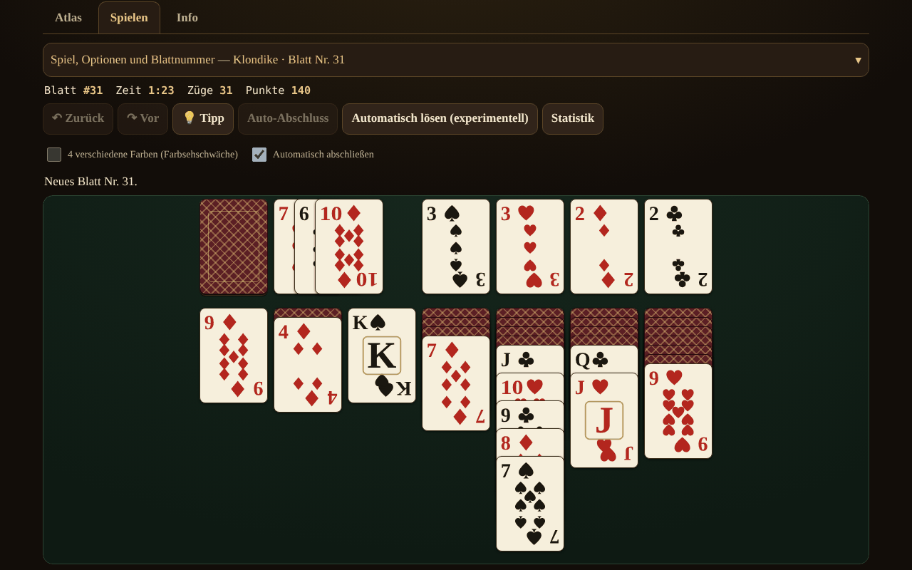

# Solitaire fără frontiere

[English](README.md) · [Română](README.ro.md) · [Français](README.fr.md) · [Italiano](README.it.md) · [Español](README.es.md) · [Português](README.pt.md) · **Deutsch** · [Magyar](README.hu.md)

**Version:** 1.2.5 · **Zuletzt aktualisiert:** 2026-10-23

Oberflächensprachen: **Română, English, Français, Italiano, Español, Português (PT), Deutsch, Magyar**

Atlas der Karten-Solitaires (Patiencen) — 13 spielbare Spiele für einen Spieler, in einer einzigen HTML-Datei, offline, ohne Konto und ohne Telemetrie.

**Online-App:** https://chiuta.github.io/Solitaire-fara-frontiere/

## Was es ist

Ein Atlas (Steckbriefe mit Herkunft, Regeln, Punktewertung, Schlagwörtern und der Schaltfläche „▶ Spielen“) plus eine gemeinsame Engine aus Stapeln / Ablagen (Foundations) / Talon / Tableau mit parametrisierten Regeln. Es gibt keinen Gegner und keine Spiel-KI: An ihrer Stelle nutzt **„Tipp“** einen Solver mit Knoten-/Zeitlimit, und **„Automatisch lösen“** (optional) führt den vom Solver gefundenen Plan aus. Die Karten sind mit eigenem SVG gezeichnet (♠♥♦♣, optionaler 4-Farben-Modus).

## Funktionen (im Code und in den Tests geprüft)

- 13 spielbare Spiele, mit Optionen (siehe Tabelle).
- Reproduzierbare Blattnummer (1 … 2.147.483.647), „neues Blatt“ (crypto.getRandomValues mit Rejection Sampling) und „gleiches Blatt“.
- Unbegrenztes Rückgängig / Wiederholen; Rückgängig stellt auch die Punktzahl exakt wieder her.
- Ziehen per Drag (Pointer Events, `touch-action`), per Klick-Klick, per Doppeltippen (automatischer Zug) und per Tastatur (Pfeile / Enter / Leertaste).
- Automatisches Vervollständigen am Ende; sichere automatische Züge auf die Ablagen (optional, abschaltbar).
- Zeitmesser, Züge, Punktzahl (siehe „Punktewertung“).
- Tipp per Solver, mit Alternativen bei wiederholtem Drücken (heuristisch gereiht, ungeprüft); „Ist es lösbar?“ nur für FreeCell, mit einem Dreizustandsergebnis: *lösbar* / *im Limit nicht gelöst* / *unbekannt* — niemals Gewissheit.
- Optionale lokale Statistiken (localStorage, in try/catch; die Anwendung funktioniert auch ohne).
- 8 Oberflächensprachen: RO / EN / FR / IT / ES / PT / DE / HU, mit automatischer Erkennung, dynamischem `lang` und einem Skript zur Schlüsselparität (155 Schlüssel × 7 Sprachen).
- Mobile-first: 390 px ohne horizontales Scrollen, adaptive Kartenüberlappung, aria-live für Meldungen, sichtbarer Fokus, `prefers-reduced-motion`, `<noscript>`.

### Spiele

| Spiel | Spielbar? | ⚠ Annäherungen / Regelentscheidungen |
|---|---|---|
| Klondike (Ziehen 1/3; 0, 1 oder 3 Durchgänge; Standard- / Vegas- / keine Wertung) | ja | Abzug von −20 bei Ziehen 3 (ab dem 4. Durchgang): durch zwei Sekundärquellen bestätigt (rarepike.com, solitairecat.com); Wikipedia nennt nur −100 bei Ziehen 1 |
| FreeCell (3/4/5 Zellen; Supermove aktivierbar) | ja | die Nummerierung der Blätter ist algorithmisch, kompatibel mit dem LCG von Microsoft (an Nr. 1 geprüft) |
| Spider (1/2/4 Farben) | ja | Wertung 500 / −1 pro Zug / +100 pro Folge; Rückgängig stellt die Punktzahl wieder her (Abweichung von klassischen Implementierungen) |
| Yukon | ja | — |
| Pyramid | ja | ⚠ oberste Karte des Talons verfügbar; standardmäßig 2 Neuverteilungen; standardmäßig „entspannter“ Sieg; eigene Wertung |
| TriPeaks | ja | ⚠ eigene Wertung (Serien); Option Wrap A–K |
| Golf | ja | ⚠ eigene Wertung (entfernte Karten); König „gesperrt“ (traditionell), Optionen Wrap / K–D |
| Scorpion | ja | — |
| Canfield | ja | ⚠ Lücken nur aus dem Abwurfstapel füllen; Verschieben einer ganzen Spalte standardmäßig strikt |
| Forty Thieves | ja | — |
| Clock | ja | reiner Zufall (≈1/13); keine Entscheidungen |
| Baker's Dozen | ja | — |
| Eight Off | ja | Lücke: König / beliebige (Option) |
| Spiderette, Seahaven Towers, Beleaguered Castle, Calculation, Accordion, Aces Up, Russian | **nur im Atlas** | Regelblätter, kein Spiel |

Klondike Aces ist nicht implementiert.

### Punktewertung

- **Klondike Standard:** Abwurf→Tableau +5, Abwurf→Ablage +10, Tableau→Ablage +10, aufgedeckte Karte +5, Ablage→Tableau −15, Recycling bei Ziehen 1: −100, bei Ziehen 3: −20 ab dem 4. Durchgang; Minimum 0; kein Zeitbonus.
- **Klondike Vegas:** −52 zu Beginn, +5 pro auf die Ablage gelegter Karte.
- Spider, TriPeaks, Golf, Pyramid, Clock: siehe die Steckbriefe im Atlas; TriPeaks und Golf verwenden eigene Konventionen, keinen offiziellen Standard.

## Anleitung

1. Öffne `index.html` (oder die Live-Seite). Der Reiter **Atlas** listet die Spiele auf; filtere oder suche.
2. Drücke **▶ Spielen** auf einem Steckbrief; wähle die Optionen (Ziehen, Farben, Zellen …) und gib, wenn du möchtest, eine Blattnummer ein.
3. Ziehe: Karte ziehen, **oder** die Karte und dann das Ziel antippen, **oder** die Pfeile + Enter verwenden. Doppeltippen auf eine Karte bringt sie automatisch dorthin, wo es möglich ist.
4. **Tipp** zeigt den nächsten Zug; **Rückgängig / Wiederholen** sind unbegrenzt; **Neues Blatt** / **Gleiches Blatt** starten neu.
5. Nur bei FreeCell: **Ist es lösbar?** führt den Solver mit Limit aus; **Automatisch lösen** führt den gefundenen Plan aus.
6. Das Bedienfeld lässt sich auf schmalen Bildschirmen einklappen.

## Datenschutz und Netzwerk

Null Netzwerkanfragen (kein fetch/XHR, keine externen Schriftarten oder CDN), null Telemetrie. Strenge CSP in `<meta>`: `default-src 'none'`, `img-src data:`, ohne `connect-src`; das Skript wird per SHA-256-Hash erlaubt (ohne `unsafe-inline` für Skripte); `style-src 'unsafe-inline'` bleibt erhalten, weil die Karten über `style`-Attribute positioniert werden. localStorage (`sol.stats.v1`, `sol.prefs.v1`) nur in try/catch. Die einzigen externen Links (Buy Me a Coffee) haben `rel="noopener"`.

## Grenzen und Warnhinweise

- **Der Solver ist keine DFS**, sondern eine Best-First-Suche (Heuristik, Portfolio aus 3 Gewichtungen) mit Knoten- und Zeitlimit. **Er sieht die verdeckten Karten** (perfekte Information): Er ist eine Hilfe, keine treue Simulation eines Spielers. Dass er keine Lösung findet, bedeutet **nicht**, dass das Blatt unlösbar ist.
- Die gemessene Lösungsrate bei Klondike (60.000 Knoten, 300 Blätter, perfekte Information) ist nur eine **untere Schranke**: Ziehen 1 ≥ 67,3 %, Ziehen 3 ≥ 59,0 % (4,7 % vollständig erschöpft).
- „Erschöpft“ bei FreeCell (z. B. Nr. 11982, 61.643 Zustände) ist ein starker Hinweis, kein formaler Beweis.
- Spider: Der Solver ist hier schwach (und vom Audit bestätigt) — bei 10 Blättern (1 Farbe, dann 2 Farben) fand er in 150.000 Knoten / 5 s keinen vollständigen Plan; der Tipp ist nur ein heuristischer Zug, kein Plan bis zum Sieg. Das automatische Lösen bei Spider ist nicht verlässlich.
- Tippziele: Bei Spielen mit ≥ 8 Spalten (Spider, Forty Thieves, Baker's Dozen, TriPeaks, FreeCell mit 5 Zellen) sind die Karten mindestens 44 px breit; auf schmalen Bildschirmen scrollt der Tisch horizontal in seinem Container (Schaltflächen ◀ ▶, Scrollen mit dem Finger auf dem Hintergrund, automatisches Scrollen beim Ziehen). Die Option „Ganzen Tisch einpassen“ kehrt zu kleinen Karten zurück. Bei 320 px haben Spiele mit 7 Spalten Karten von 40 px, und der sichtbare Höhenanteil überlappender Karten in den Spalten beträgt < 44 px (inhärent beim Solitaire).
- Tastenkürzel (U/Y/H/A/N) sind nur aktiv, wenn der Tisch den Fokus hat; N verlangt zwei Tastendrücke, wenn das Spiel begonnen wurde.
- Der Solver hat eine Speicherobergrenze (30.000 offene Zustände) und läuft in kurzen Abschnitten; der heuristische „Tipp“ ist mit „ungeprüft, kann in eine blockierte Stellung führen“ gekennzeichnet.
- Die Meldung „keine nützlichen Züge mehr“ kann in blockierten Stellungen fehlen, in denen es noch wirkungslose Züge gibt (z. B. eine ganze Spalte auf eine leere Spalte) oder unbegrenztes Recycling des Talons.
- „Neues Blatt“ wählt aus 1.000.000 Nummern (wie beim Microsoft-FreeCell), nicht aus allen möglichen Permutationen.
- Die langen Texte im Atlas sind nur in RO und EN vollständig; in FR/IT/ES/PT/DE/HU wird Englisch mit dem Hinweis „Text auf Englisch“ angezeigt. Schaltflächen und Meldungen sind in allen 8 Sprachen übersetzt.
- Die Tests liegen außerhalb des Pakets (sie sind nicht Teil des Repos).

## Verlauf / Changelog

### 1.2.5 — 2026-10-23

- Touch-Ziele von mindestens 44 px auf Touch-Geräten (`pointer:coarse`); der Desktop bleibt unverändert.

### 1.2.3 — 2026-10-22

fff-kit 1.1.4: Touch-Ziele und Mindestschriftgröße.

- 1.2.2 — 2026-10-22: fff-kit 1.1.2: PBKDF2 mit 600.000 Iterationen, Schutz vor Clickjacking
- 1.1.0 — 2026-10-14: Sicherungskopie und Datenkennzeichnung (fff-kit).

- 1.0.4 — 2026-10-12: Version und Datum der letzten Aktualisierung werden in der Anwendung angezeigt
- Auf Bildschirmen mit einer Höhe unter 900 px (z. B. 1280×800) startet das Feld „Spiel und Optionen“ geschlossen, damit der Spieltisch ohne Scrollen sichtbar ist (die Zusammenfassung zeigt das Spiel und die Blattnummer; ein Chevron ▾ und ein Klick öffnen es); auf hohen Bildschirmen bleibt es geöffnet. Ziehen, Rückgängig und Spielwechsel wurden nach der Änderung geprüft.
- Die Reiter Atlas / Spielen / Info und das Unterstützungs-Widget befinden sich jetzt in semantischen Landmarks (`main`, `complementary`); axe-core: 0 Verstöße bei 1280 und 360 px.
- Der CSP-Hash des Skripts wurde nach der Aktualisierung der Versionsnummer neu berechnet (v1.0 → v1.0.1).
- „Tipp“: Wiederholtes Drücken auf derselben Stellung liefert jetzt alternative Züge (heuristisch gereiht, als „ungeprüft“ markiert), bis kein nützlicher Zug mehr übrig ist („Ich habe keine weiteren Züge vorzuschlagen“); 2 neue Oberflächenschlüssel in allen 7 Sprachen (155 Schlüssel × 7 Sprachen).

## Quellen

Konsultierte Regeln: Wikipedia (Klondike, FreeCell, Spider, Yukon, Pyramid, Golf, Scorpion, Canfield, Forty Thieves, Clock, Baker's Dozen, Eight Off); solitairebliss.com (TriPeaks); solitairelaboratory.com (Golf); der Blattgenerator des Microsoft-FreeCell (LCG `s = s·214013 + 2531011 mod 2^31`, Ergebnis `s >> 16`), an dem bekannten Blatt Nr. 1 geprüft. Das Blatt Nr. 11982 (bekanntermaßen unlösbar) wird vom Solver als „Raum erschöpft“ gemeldet; die Tatsache beruht auf der FreeCell-Literatur, nicht auf einer hier konsultierten Quelle.

## Lokale Ausführung

Öffne `index.html` in einem Browser — es sind kein Server, kein Build und keine Installation nötig.

## Lizenz

MIT — siehe die Datei LICENSE.

## Autor

Alexio — Alexandru-Ionuț Chiuță (alexio@trom.tf)

## Zusammenfassung

Ein einteiliger Offline-Atlas mit 13 spielbaren Solitaire-Spielen für einen Spieler (Klondike, FreeCell, Spider, Yukon, Pyramid, TriPeaks, Golf, Scorpion, Canfield, Forty Thieves, Clock, Baker's Dozen, Eight Off) plus 7 reinen Atlas-Einträgen. Reproduzierbare Blattnummern, unbegrenztes Rückgängig/Wiederholen, Spielen per Ziehen / Klick / Tastatur und ein knotenbegrenzter Best-First-Solver für Tipps und ein optionales automatisches Lösen (er sieht verdeckte Karten; ein Misserfolg beweist nie die Unlösbarkeit). Eigene SVG-Karten, 8 Oberflächensprachen, strenge CSP, kein Netzwerk, keine Telemetrie. Mit ⚠ gekennzeichnet, wo Regeln angenähert sind; die Lösungsraten bei Klondike werden nur als untere Schranken angegeben.
