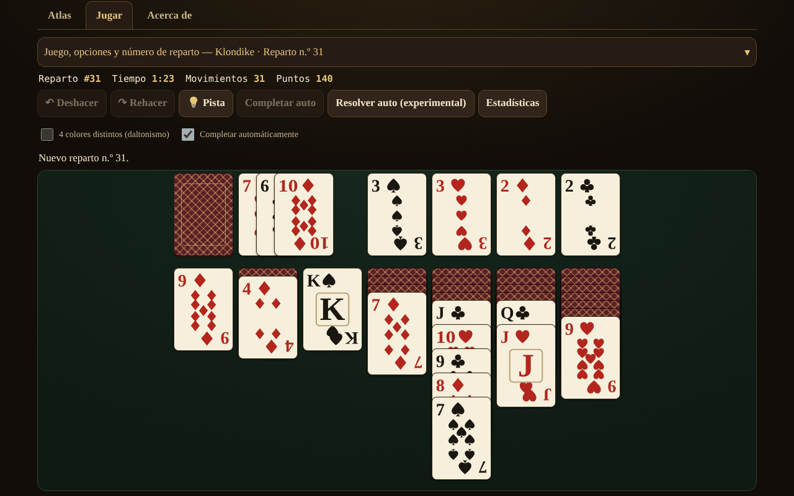

# Solitaire fără frontiere

[English](README.md) · [Română](README.ro.md) · [Français](README.fr.md) · [Italiano](README.it.md) · **Español** · [Português](README.pt.md) · [Deutsch](README.de.md) · [Magyar](README.hu.md)

**Versión:** 1.2.0 · **Última actualización:** 2026-10-19

Idiomas de la interfaz: **Română, English, Français, Italiano, Español, Português (PT), Deutsch, Magyar**

Atlas de solitarios (paciencias) de cartas — 13 juegos para un solo jugador, en un único archivo HTML, sin conexión, sin cuenta y sin telemetría.

**Aplicación en línea:** https://chiuta.github.io/Solitaire-fara-frontiere/

## Qué es

Un atlas (fichas con origen, reglas, puntuación, etiquetas y el botón «▶ Jugar») más un motor común de pilas / fundaciones / mazo / tableau con reglas parametrizadas. No hay adversario ni IA de juego: en su lugar, **«Pista»** usa un solver con límite de nodos/tiempo, y **«Resolver automáticamente»** (opcional) ejecuta el plan encontrado por el solver. Las cartas se dibujan con SVG propio (♠♥♦♣, modo opcional de 4 colores).

## Funciones (comprobadas en el código y en las pruebas)

- 13 juegos jugables, con opciones (véase la tabla).
- Número de reparto reproducible (1 … 2 147 483 647), «nuevo reparto» (crypto.getRandomValues con muestreo por rechazo) y «mismo reparto».
- Deshacer / Rehacer ilimitados; Deshacer restaura también exactamente la puntuación.
- Movimiento arrastrando (pointer events, `touch-action`), con clic-clic, con doble toque (movimiento automático) y desde el teclado (flechas / Intro / Espacio).
- Autocompletado al final; jugadas seguras automáticas hacia las fundaciones (opcional, desactivable).
- Cronómetro, movimientos, puntuación (véase «Puntuación»).
- Pista mediante solver, con alternativas en pulsaciones repetidas (clasificadas heurísticamente, sin verificar); «¿Se puede resolver?» solo para FreeCell, con un resultado de tres estados: *resoluble* / *no resuelto dentro del límite* / *no lo sé* — nunca certeza.
- Estadísticas locales opcionales (localStorage, en try/catch; la aplicación funciona también sin ellas).
- 8 idiomas de interfaz: RO / EN / FR / IT / ES / PT / DE / HU, con detección automática, `lang` dinámico y script de paridad de claves (155 claves × 7 idiomas).
- Mobile-first: 390 px sin desplazamiento horizontal, solapamiento adaptable de cartas, aria-live para mensajes, foco visible, `prefers-reduced-motion`, `<noscript>`.

### Juegos

| Juego | ¿Jugable? | ⚠ Aproximaciones / elecciones de reglas |
|---|---|---|
| Klondike (robo 1/3; 0, 1 o 3 pasadas; puntuación estándar / Vegas / ninguna) | sí | Penalización de −20 en el robo de 3 (a partir de la 4.ª pasada): confirmada por dos fuentes secundarias (rarepike.com, solitairecat.com); Wikipedia solo da −100 en el robo de 1 |
| FreeCell (3/4/5 celdas; supermovimiento activable) | sí | la numeración de los repartos es algorítmica, compatible con el LCG de Microsoft (verificada en el n.º 1) |
| Spider (1/2/4 palos) | sí | puntuación 500 / −1 por movimiento / +100 por secuencia; Deshacer restaura la puntuación (diferencia respecto a las implementaciones clásicas) |
| Yukon | sí | — |
| Pyramid | sí | ⚠ parte superior del mazo disponible; 2 redistribuciones por defecto; victoria «relajada» por defecto; puntuación propia |
| TriPeaks | sí | ⚠ puntuación propia (rachas); opción de ciclo A–K |
| Golf | sí | ⚠ puntuación propia (cartas eliminadas); Rey «bloqueado» (tradicional), opciones de ciclo / K–Q |
| Scorpion | sí | — |
| Canfield | sí | ⚠ relleno de huecos solo desde el descarte; movimiento de la columna entera estricto por defecto |
| Forty Thieves | sí | — |
| Clock | sí | puro azar (≈1/13); sin decisiones |
| Baker's Dozen | sí | — |
| Eight Off | sí | hueco: rey / cualquiera (opción) |
| Spiderette, Seahaven Towers, Beleaguered Castle, Calculation, Accordion, Aces Up, Russian | **solo en el atlas** | fichas de reglas, sin juego |

Klondike Aces no está implementado.

### Puntuación

- **Klondike estándar:** descarte→tableau +5, descarte→fundación +10, tableau→fundación +10, carta descubierta +5, fundación→tableau −15, reciclado en robo de 1: −100, en robo de 3: −20 desde la 4.ª pasada; mínimo 0; sin bonificación de tiempo.
- **Klondike Vegas:** −52 al principio, +5 por carta subida a la fundación.
- Spider, TriPeaks, Golf, Pyramid, Clock: véanse las fichas del atlas; TriPeaks y Golf usan convenciones propias, no un estándar oficial.

## Manual de uso

1. Abre `index.html` (o la página en línea). La pestaña **Atlas** enumera los juegos; filtra o busca.
2. Pulsa **▶ Jugar** en una ficha; elige las opciones (robo, palos, celdas…) y, si quieres, escribe un número de reparto.
3. Mueve: arrastra una carta, **o** pulsa la carta y luego el destino, **o** usa las flechas + Intro. El doble toque en una carta la lleva automáticamente donde sea posible.
4. **Pista** muestra el siguiente movimiento; **Deshacer / Rehacer** son ilimitados; **Nuevo reparto** / **Mismo reparto** reinician.
5. Solo en FreeCell: **¿Se puede resolver?** ejecuta el solver con un límite; **Resolver automáticamente** ejecuta el plan encontrado.
6. El panel de controles es plegable en pantallas estrechas.

## Privacidad y red

Cero peticiones de red (sin fetch/XHR, sin fuentes ni CDN externos), cero telemetría. CSP estricta en `<meta>`: `default-src 'none'`, `img-src data:`, sin `connect-src`; el script se permite mediante hash SHA-256 (sin `unsafe-inline` para scripts); `style-src 'unsafe-inline'` se mantiene porque las cartas se posicionan mediante atributos `style`. localStorage (`sol.stats.v1`, `sol.prefs.v1`) solo en try/catch. Los únicos enlaces externos (Buy Me a Coffee) tienen `rel="noopener"`.

## Límites y advertencias

- **El solver no es DFS**, sino una búsqueda primero-el-mejor (heurística, cartera de 3 ponderaciones) con límite de nodos y de tiempo. **Ve las cartas ocultas** (información perfecta): es una ayuda, no una simulación fiel de un jugador. El hecho de que no encuentre solución **no** significa que el reparto sea irresoluble.
- La tasa de resolución de Klondike medida (60 000 nodos, 300 repartos, información perfecta) es solo una **cota inferior**: robo 1 ≥ 67,3 %, robo 3 ≥ 59,0 % (4,7 % completamente agotados).
- «Agotado» en FreeCell (p. ej. n.º 11982, 61 643 estados) es un indicio fuerte, no una demostración formal.
- Spider: el solver es débil aquí (y la auditoría lo confirma) — en 10 repartos (1 palo, luego 2 palos) no encontró ningún plan completo en 150 000 nodos / 5 s; la pista es solo un movimiento heurístico, no un plan hasta la victoria. La resolución automática de Spider no es fiable.
- Objetivos táctiles: en los juegos con ≥ 8 columnas (Spider, Forty Thieves, Baker's Dozen, TriPeaks, FreeCell con 5 celdas) las cartas tienen al menos 44 px de ancho; en pantallas estrechas la mesa se desplaza horizontalmente dentro de su contenedor (botones ◀ ▶, desplazamiento con el dedo sobre el fondo, desplazamiento automático al arrastrar). La opción «Ajustar toda la mesa» vuelve a cartas pequeñas. A 320 px los juegos de 7 columnas tienen cartas de 40 px, y la parte visible en altura de las cartas solapadas en las columnas es < 44 px (inherente al solitario).
- Los atajos de teclado (U/Y/H/A/N) solo están activos con la mesa en foco; N pide dos pulsaciones si la partida ha empezado.
- El solver tiene un tope de memoria (30 000 estados abiertos) y se ejecuta en fragmentos cortos; la «Pista» heurística está etiquetada como «sin verificar, puede llevar a una posición bloqueada».
- El mensaje «no quedan movimientos útiles» puede faltar en posiciones bloqueadas en las que aún existen movimientos sin efecto (p. ej. una columna entera a una columna vacía) o reciclados ilimitados del mazo.
- «Nuevo reparto» elige entre 1 000 000 de números (como en el FreeCell de Microsoft), no entre todas las permutaciones posibles.
- Los textos largos del atlas están completos solo en RO y EN; en FR/IT/ES/PT/DE/HU se muestra el inglés con la nota «texto en inglés». Los botones y los mensajes están traducidos a los 8 idiomas.
- Las pruebas están fuera del paquete (no forman parte del repositorio).

## Historial / Registro de cambios

- 1.1.0 — 2026-10-14: copia de seguridad y etiquetado de datos (fff-kit).

- 1.0.4 — 2026-10-12: la versión y la fecha de la última actualización se muestran en la aplicación
- En pantallas con altura inferior a 900 px (p. ej. 1280×800) el panel «Juego y opciones» arranca cerrado, para que la mesa de juego sea visible sin desplazarse (el resumen muestra el juego y el número de reparto; un chevron ▾ y un clic lo abren); en pantallas altas permanece abierto. Se verificaron el movimiento, Deshacer y el cambio de juego tras la modificación.
- Las pestañas Atlas / Jugar / Acerca de y el widget de apoyo están ahora en puntos de referencia semánticos (`main`, `complementary`); axe-core: 0 infracciones a 1280 y 360 px.
- El hash CSP del script se recalculó tras actualizar el número de versión (v1.0 → v1.0.1).
- «Pista»: las pulsaciones repetidas sobre la misma posición dan ahora movimientos alternativos (clasificados heurísticamente, marcados «sin verificar»), hasta que no queda ningún movimiento útil («No tengo más movimientos que sugerir»); 2 claves de interfaz nuevas en los 7 idiomas (155 claves × 7 idiomas).

## Fuentes

Reglas consultadas: Wikipedia (Klondike, FreeCell, Spider, Yukon, Pyramid, Golf, Scorpion, Canfield, Forty Thieves, Clock, Baker's Dozen, Eight Off); solitairebliss.com (TriPeaks); solitairelaboratory.com (Golf); el generador de repartos de Microsoft FreeCell (LCG `s = s·214013 + 2531011 mod 2^31`, resultado `s >> 16`), verificado en el reparto n.º 1 conocido. El reparto n.º 11982 (conocido como irresoluble) es notificado por el solver como «espacio agotado»; el hecho se basa en la literatura sobre FreeCell, no en una fuente consultada aquí.

## Ejecución local

Abre `index.html` en un navegador — no necesita servidor, compilación ni instalación.

## Licencia

MIT — véase el archivo LICENSE.

## Autor

Alexio — Alexandru-Ionuț Chiuță (alexio@trom.tf)

## Resumen

Un atlas sin conexión, en un único archivo, de 13 juegos de solitario jugables para un solo jugador (Klondike, FreeCell, Spider, Yukon, Pyramid, TriPeaks, Golf, Scorpion, Canfield, Forty Thieves, Clock, Baker's Dozen, Eight Off) más 7 entradas solo de atlas. Números de reparto reproducibles, deshacer/rehacer ilimitados, juego con arrastre / clic / teclado, y un solver primero-el-mejor con límite de nodos para las pistas y una resolución automática opcional (ve las cartas ocultas; un fallo nunca prueba la irresolubilidad). Cartas SVG propias, 8 idiomas de interfaz, CSP estricta, sin red, sin telemetría. Marcado con ⚠ donde las reglas son aproximadas; las tasas de resolución de Klondike se indican solo como cotas inferiores.
