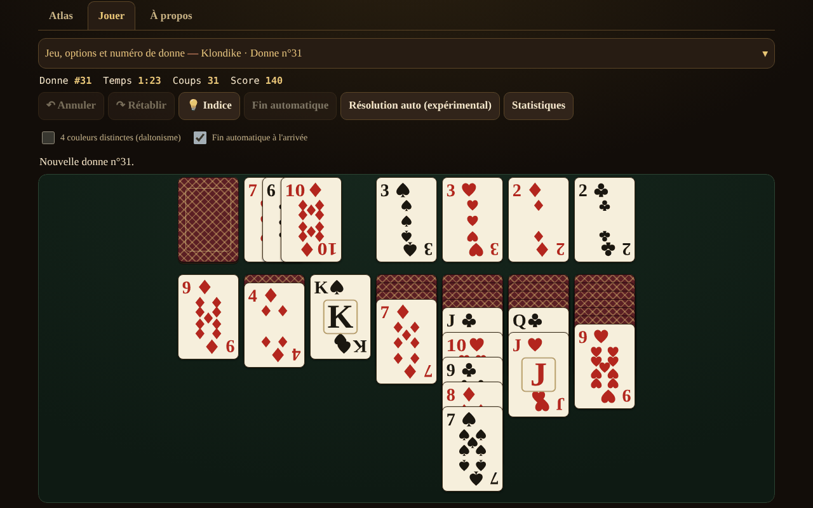

# Solitaire fără frontiere

[English](README.md) · [Română](README.ro.md) · **Français** · [Italiano](README.it.md) · [Español](README.es.md) · [Português](README.pt.md) · [Deutsch](README.de.md) · [Magyar](README.hu.md)

**Version :** 1.2.3 · **Dernière mise à jour :** 2026-10-22

Langues de l'interface : **Română, English, Français, Italiano, Español, Português (PT), Deutsch, Magyar**

Atlas de solitaires (patiences) de cartes — 13 jeux jouables à un seul joueur, dans un seul fichier HTML, hors ligne, sans compte et sans télémétrie.

**Application en ligne :** https://chiuta.github.io/Solitaire-fara-frontiere/

## Présentation

Un atlas (fiches avec origine, règles, décompte des points, étiquettes et bouton « ▶ Jouer ») plus un moteur commun de piles / fondations / talon / tableau avec des règles paramétrées. Il n'y a ni adversaire ni IA de jeu : à leur place, **« Indice »** utilise un solveur limité en nœuds/temps, et **« Résoudre automatiquement »** (facultatif) exécute le plan trouvé par le solveur. Les cartes sont dessinées avec un SVG maison (♠♥♦♣, mode facultatif à 4 couleurs).

## Fonctionnalités (vérifiées dans le code et dans les tests)

- 13 jeux jouables, avec options (voir le tableau).
- Numéro de donne reproductible (1 … 2 147 483 647), « nouvelle donne » (crypto.getRandomValues avec échantillonnage par rejet) et « même donne ».
- Annuler / Rétablir illimités ; Annuler restaure aussi exactement le score.
- Déplacement par glisser-déposer (pointer events, `touch-action`), par clic-clic, par double-tap (déplacement automatique) et au clavier (flèches / Entrée / Espace).
- Complétion automatique en fin de partie ; coups sûrs automatiques vers les fondations (facultatif, désactivable).
- Chronomètre, coups, score (voir « Décompte des points »).
- Indice par solveur, avec des alternatives en cas d'appuis répétés (classées heuristiquement, non vérifiées) ; « Est-ce résoluble ? » uniquement pour FreeCell, avec un résultat à trois états : *résoluble* / *non résolu dans la limite* / *je ne sais pas* — jamais une certitude.
- Statistiques locales facultatives (localStorage, dans un try/catch ; l'application fonctionne aussi sans).
- 8 langues d'interface : RO / EN / FR / IT / ES / PT / DE / HU, avec détection automatique, `lang` dynamique et script de parité des clés (155 clés × 7 langues).
- Mobile d'abord : 390 px sans défilement horizontal, chevauchement adaptatif des cartes, aria-live pour les messages, focus visible, `prefers-reduced-motion`, `<noscript>`.

### Jeux

| Jeu | Jouable ? | ⚠ Approximations / choix de règles |
|---|---|---|
| Klondike (pioche 1/3 ; 0, 1 ou 3 passages ; décompte standard / Vegas / sans) | oui | Pénalité de −20 à la pioche de 3 (à partir du 4e passage) : confirmée par deux sources secondaires (rarepike.com, solitairecat.com) ; Wikipédia ne donne que −100 pour la pioche de 1 |
| FreeCell (3/4/5 cellules ; supermouvement activable) | oui | la numérotation des donnes est algorithmique, compatible avec le LCG de Microsoft (vérifiée sur la n° 1) |
| Spider (1/2/4 couleurs) | oui | décompte 500 / −1 par coup / +100 par séquence ; Annuler restaure le score (différence par rapport aux implémentations classiques) |
| Yukon | oui | — |
| Pyramid | oui | ⚠ haut du talon disponible ; 2 redistributions par défaut ; victoire « assouplie » par défaut ; décompte propre |
| TriPeaks | oui | ⚠ décompte propre (séries) ; option de bouclage A–R |
| Golf | oui | ⚠ décompte propre (cartes retirées) ; Roi « bloqué » (traditionnel), options de bouclage / R–D |
| Scorpion | oui | — |
| Canfield | oui | ⚠ remplissage des vides uniquement depuis la défausse ; déplacement d'une colonne entière strict par défaut |
| Forty Thieves | oui | — |
| Clock | oui | pur hasard (≈1/13) ; aucune décision |
| Baker's Dozen | oui | — |
| Eight Off | oui | vide : roi / n'importe quelle carte (option) |
| Spiderette, Seahaven Towers, Beleaguered Castle, Calculation, Accordion, Aces Up, Russian | **atlas seulement** | fiches de règles, sans jeu |

Klondike Aces n'est pas implémenté.

### Décompte des points

- **Klondike standard :** défausse→tableau +5, défausse→fondation +10, tableau→fondation +10, carte retournée +5, fondation→tableau −15, recyclage à la pioche de 1 : −100, à la pioche de 3 : −20 à partir du 4e passage ; minimum 0 ; pas de bonus de temps.
- **Klondike Vegas :** −52 au départ, +5 par carte montée sur la fondation.
- Spider, TriPeaks, Golf, Pyramid, Clock : voir les fiches de l'atlas ; TriPeaks et Golf utilisent des conventions propres, pas un standard officiel.

## Mode d'emploi

1. Ouvrez `index.html` (ou la page en ligne). L'onglet **Atlas** liste les jeux ; filtrez ou cherchez.
2. Appuyez sur **▶ Jouer** sur une fiche ; choisissez les options (pioche, couleurs, cellules…) et, si vous le souhaitez, saisissez un numéro de donne.
3. Déplacez : glissez une carte, **ou** appuyez sur la carte puis sur la destination, **ou** utilisez les flèches + Entrée. Un double-tap sur une carte l'envoie automatiquement là où c'est possible.
4. **Indice** montre le coup suivant ; **Annuler / Rétablir** sont illimités ; **Nouvelle donne** / **Même donne** relancent la partie.
5. Uniquement pour FreeCell : **Est-ce résoluble ?** lance le solveur avec une limite ; **Résoudre automatiquement** exécute le plan trouvé.
6. Le panneau de commandes est repliable sur les écrans étroits.

## Confidentialité et réseau

Zéro requête réseau (pas de fetch/XHR, pas de polices ni de CDN externes), zéro télémétrie. CSP stricte dans `<meta>` : `default-src 'none'`, `img-src data:`, sans `connect-src` ; le script est autorisé par hachage SHA-256 (sans `unsafe-inline` pour les scripts) ; `style-src 'unsafe-inline'` est conservé parce que les cartes sont positionnées par des attributs `style`. localStorage (`sol.stats.v1`, `sol.prefs.v1`) uniquement dans un try/catch. Les seuls liens externes (Buy Me a Coffee) ont `rel="noopener"`.

## Limites et avertissements

- **Le solveur n'est pas un DFS**, mais une recherche meilleur-d'abord (heuristique, portefeuille de 3 pondérations) avec limite de nœuds et de temps. **Il voit les cartes cachées** (information parfaite) : c'est une aide, pas une simulation fidèle d'un joueur. Le fait qu'il ne trouve pas de solution **ne** signifie **pas** que la donne est irrésoluble.
- Le taux de résolution mesuré pour Klondike (60 000 nœuds, 300 donnes, information parfaite) n'est qu'une **borne inférieure** : pioche 1 ≥ 67,3 %, pioche 3 ≥ 59,0 % (4,7 % entièrement épuisées).
- « Épuisé » à FreeCell (p. ex. n° 11982, 61 643 états) est un indice fort, pas une démonstration formelle.
- Spider : le solveur est faible ici (et l'audit le confirme) — sur 10 donnes (1 couleur, puis 2 couleurs), il n'a trouvé aucun plan complet en 150 000 nœuds / 5 s ; l'indice n'est qu'un coup heuristique, pas un plan jusqu'à la victoire. La résolution automatique de Spider n'est pas fiable.
- Cibles tactiles : pour les jeux à ≥ 8 colonnes (Spider, Forty Thieves, Baker's Dozen, TriPeaks, FreeCell à 5 cellules), les cartes font au moins 44 px de large ; sur les écrans étroits, la table défile horizontalement dans son conteneur (boutons ◀ ▶, défilement au doigt sur le fond, défilement automatique pendant le glissement). L'option « Ajuster toute la table » revient à de petites cartes. À 320 px, les jeux à 7 colonnes ont des cartes de 40 px, et la hauteur visible des cartes qui se chevauchent dans les colonnes est < 44 px (inhérent au solitaire).
- Les raccourcis clavier (U/Y/H/A/N) ne sont actifs que lorsque la table a le focus ; N demande deux appuis si la partie est commencée.
- Le solveur a un plafond de mémoire (30 000 états ouverts) et s'exécute par courts fragments ; l'« Indice » heuristique est étiqueté « non vérifié, peut mener à une position bloquée ».
- Le message « il n'y a plus de coups utiles » peut manquer dans des positions bloquées où il reste des coups sans effet (p. ex. une colonne entière vers une colonne vide) ou des recyclages illimités du talon.
- « Nouvelle donne » choisit parmi 1 000 000 de numéros (comme dans le FreeCell de Microsoft), et non parmi toutes les permutations possibles.
- Les textes longs de l'atlas ne sont complets qu'en RO et EN ; en FR/IT/ES/PT/DE/HU, l'anglais est affiché avec la mention « texte en anglais ». Les boutons et les messages sont traduits dans les 8 langues.
- Les tests sont en dehors du paquet (ils ne font pas partie du dépôt).

## Historique / Journal des modifications

### 1.2.3 — 2026-10-22

fff-kit 1.1.4 : cibles tactiles et taille de texte minimale.

- 1.2.2 — 2026-10-22 : fff-kit 1.1.2 : PBKDF2 à 600 000 itérations, protection anti-clickjacking
- 1.1.0 — 2026-10-14 : sauvegarde et étiquetage des données (fff-kit).

- 1.0.4 — 2026-10-12 : la version et la date de dernière mise à jour sont affichées dans l'application
- Sur les écrans de moins de 900 px de hauteur (p. ex. 1280×800), le panneau « Jeu et options » démarre fermé, afin que la table de jeu soit visible sans défilement (le résumé indique le jeu et le numéro de donne ; un chevron ▾ et un clic l'ouvrent) ; sur les écrans hauts, il reste ouvert. Le déplacement, Annuler et le changement de jeu ont été vérifiés après la modification.
- Les onglets Atlas / Jouer / À propos et le widget de soutien sont désormais dans des repères sémantiques (`main`, `complementary`) ; axe-core : 0 violation à 1280 et 360 px.
- Le hachage CSP du script a été recalculé après la mise à jour du numéro de version (v1.0 → v1.0.1).
- « Indice » : des appuis répétés sur la même position donnent désormais des coups alternatifs (classés heuristiquement, marqués « non vérifié »), jusqu'à ce qu'il ne reste plus aucun coup utile (« Je n'ai plus d'autres coups à suggérer ») ; 2 nouvelles clés d'interface dans les 8 langues (155 clés × 7 langues).

## Sources

Règles consultées : Wikipédia (Klondike, FreeCell, Spider, Yukon, Pyramid, Golf, Scorpion, Canfield, Forty Thieves, Clock, Baker's Dozen, Eight Off) ; solitairebliss.com (TriPeaks) ; solitairelaboratory.com (Golf) ; le générateur de donnes de FreeCell de Microsoft (LCG `s = s·214013 + 2531011 mod 2^31`, résultat `s >> 16`), vérifié sur la donne n° 1 connue. La donne n° 11982 (connue pour être irrésoluble) est signalée par le solveur comme « espace épuisé » ; ce fait repose sur la littérature consacrée à FreeCell, et non sur une source consultée ici.

## Exécution locale

Ouvrez `index.html` dans un navigateur — aucun serveur, compilation ou installation n'est nécessaire.

## Licence

MIT — voir le fichier LICENSE.

## Auteur

Alexio — Alexandru-Ionuț Chiuță (alexio@trom.tf)

## Résumé

Un atlas hors ligne, en un seul fichier, de 13 jeux de solitaire jouables à un joueur (Klondike, FreeCell, Spider, Yukon, Pyramid, TriPeaks, Golf, Scorpion, Canfield, Forty Thieves, Clock, Baker's Dozen, Eight Off) plus 7 entrées réservées à l'atlas. Numéros de donne reproductibles, annulation/rétablissement illimités, jeu au glisser / au clic / au clavier, et un solveur meilleur-d'abord limité en nœuds pour les indices et une résolution automatique facultative (il voit les cartes cachées ; un échec ne prouve jamais l'irrésolubilité). Cartes en SVG maison, 8 langues d'interface, CSP stricte, aucun réseau, aucune télémétrie. Marqué ⚠ là où les règles sont approximées ; les taux de résolution de Klondike ne sont donnés que comme bornes inférieures.
