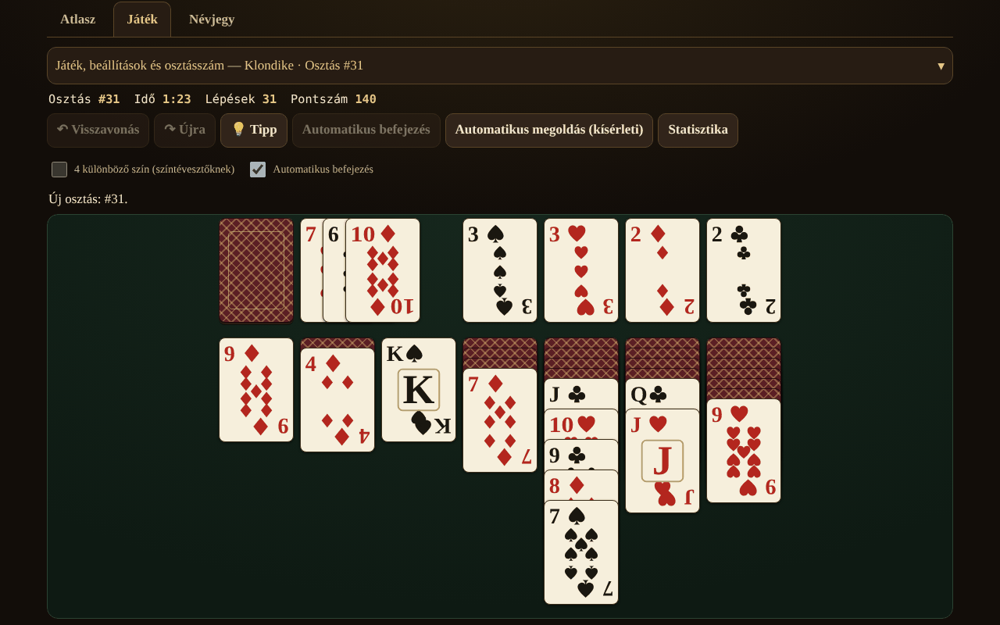

# Solitaire fără frontiere

[English](README.md) · [Română](README.ro.md) · [Français](README.fr.md) · [Italiano](README.it.md) · [Español](README.es.md) · [Português](README.pt.md) · [Deutsch](README.de.md) · **Magyar**

**Verzió:** 1.2.5 · **Utolsó frissítés:** 2026-10-23

A felület nyelvei: **Română, English, Français, Italiano, Español, Português (PT), Deutsch, Magyar**

Kártyás pasziánszok (patience) atlasza — 13 egyszemélyes, játszható játék egyetlen HTML-fájlban, offline, fiók és telemetria nélkül.

**Online alkalmazás:** https://chiuta.github.io/Solitaire-fara-frontiere/

## Mi ez

Egy atlasz (lapok eredettel, szabályokkal, pontozással, címkékkel és a „▶ Játék” gombbal), valamint egy közös motor oszlopokkal / alapokkal / pakli­val / asztallal (tableau), paraméterezett szabályokkal. Nincs ellenfél és nincs játék-MI: helyette a **„Tipp”** csomópont-/időkorláttal rendelkező megoldót használ, az **„Automatikus megoldás”** (opcionális) pedig a megoldó által talált tervet futtatja le. A kártyák saját SVG-vel vannak megrajzolva (♠♥♦♣, opcionális 4 színű mód).

## Funkciók (kódban és tesztekben ellenőrizve)

- 13 játszható játék, opciókkal (lásd a táblázatot).
- Reprodukálható leosztásszám (1 … 2 147 483 647), „új leosztás” (crypto.getRandomValues elutasításos mintavételezéssel) és „ugyanaz a leosztás”.
- Korlátlan Visszavonás / Mégis; a Visszavonás a pontszámot is pontosan visszaállítja.
- Mozgatás húzással (pointer events, `touch-action`), kattintás-kattintással, dupla koppintással (automatikus lépés) és billentyűzetről (nyilak / Enter / Szóköz).
- Automatikus befejezés a végén; biztonságos automatikus lépések az alapokra (opcionális, kikapcsolható).
- Időmérő, lépések, pontszám (lásd „Pontozás”).
- Tipp a megoldón keresztül, ismételt megnyomáskor alternatívákkal (heurisztikusan rangsorolva, ellenőrizetlenül); a „Megoldható?” csak a FreeCellnél, háromállapotú eredménnyel: *megoldható* / *a korláton belül nem megoldott* / *nem tudom* — soha nem bizonyosság.
- Opcionális helyi statisztikák (localStorage, try/catch-ben; az alkalmazás nélkülük is működik).
- 8 felületi nyelv: RO / EN / FR / IT / ES / PT / DE / HU, automatikus felismeréssel, dinamikus `lang` attribútummal és kulcsparitás-ellenőrző szkripttel (155 kulcs × 7 nyelv).
- Mobile-first: 390 px vízszintes görgetés nélkül, adaptív kártyaátfedés, aria-live az üzenetekhez, látható fókusz, `prefers-reduced-motion`, `<noscript>`.

### Játékok

| Játék | Játszható? | ⚠ Közelítések / szabályválasztások |
|---|---|---|
| Klondike (húzás 1/3; 0, 1 vagy 3 átfordulás; szabványos / Vegas / pontozás nélkül) | igen | A −20 büntetés 3-as húzásnál (a 4. átfordulástól): két másodlagos forrás megerősíti (rarepike.com, solitairecat.com); a Wikipédia csak −100-at ad 1-es húzásnál |
| FreeCell (3/4/5 cella; szupermozgás bekapcsolható) | igen | a leosztások számozása algoritmikus, a Microsoft LCG-jével kompatibilis (az 1. számún ellenőrizve) |
| Spider (1/2/4 szín) | igen | pontozás 500 / −1 lépésenként / +100 sorozatonként; a Visszavonás visszaállítja a pontszámot (eltérés a klasszikus megvalósításoktól) |
| Yukon | igen | — |
| Pyramid | igen | ⚠ a pakli teteje elérhető; alapértelmezés szerint 2 újraosztás; alapértelmezés szerint „könnyített” győzelem; saját pontozás |
| TriPeaks | igen | ⚠ saját pontozás (sorozatok); A–K körbeforgatás opció |
| Golf | igen | ⚠ saját pontozás (eltávolított lapok); a király „elakad” (hagyományos), körbeforgatás / K–Q opciók |
| Scorpion | igen | — |
| Canfield | igen | ⚠ az üres helyek feltöltése csak a dobópakliból; egy egész oszlop mozgatása alapértelmezés szerint szigorú |
| Forty Thieves | igen | — |
| Clock | igen | tiszta szerencse (≈1/13); nincsenek döntések |
| Baker's Dozen | igen | — |
| Eight Off | igen | üres hely: király / bármi (opció) |
| Spiderette, Seahaven Towers, Beleaguered Castle, Calculation, Accordion, Aces Up, Russian | **csak az atlaszban** | szabálylapok, játék nélkül |

A Klondike Aces nincs megvalósítva.

### Pontozás

- **Szabványos Klondike:** dobópakli→asztal +5, dobópakli→alap +10, asztal→alap +10, felfordított lap +5, alap→asztal −15, újrahasznosítás 1-es húzásnál: −100, 3-as húzásnál: −20 a 4. átfordulástól; minimum 0; nincs időbónusz.
- **Vegas Klondike:** −52 az elején, +5 minden alapra feltett lapért.
- Spider, TriPeaks, Golf, Pyramid, Clock: lásd az atlasz lapjait; a TriPeaks és a Golf saját konvenciókat használ, nem hivatalos szabványt.

## Használati útmutató

1. Nyisd meg az `index.html` fájlt (vagy az online oldalt). Az **Atlasz** fül felsorolja a játékokat; szűrj vagy keress.
2. Nyomd meg a **▶ Játék** gombot egy lapon; válaszd ki az opciókat (húzás, színek, cellák…), és ha szeretnéd, írj be egy leosztásszámot.
3. Mozgatás: húzz egy kártyát, **vagy** nyomd meg a kártyát, majd a célt, **vagy** használd a nyilakat + Entert. Egy kártya dupla koppintása automatikusan oda viszi, ahová lehet.
4. A **Tipp** megmutatja a következő lépést; a **Visszavonás / Mégis** korlátlan; az **Új leosztás** / **Ugyanaz a leosztás** újraindít.
5. Csak a FreeCellnél: a **Megoldható?** korláttal futtatja a megoldót; az **Automatikus megoldás** végrehajtja a talált tervet.
6. A vezérlőpanel keskeny képernyőkön összecsukható.

## Adatvédelem és hálózat

Nulla hálózati kérés (nincs fetch/XHR, nincsenek külső betűtípusok vagy CDN), nulla telemetria. Szigorú CSP a `<meta>` elemben: `default-src 'none'`, `img-src data:`, `connect-src` nélkül; a szkript SHA-256 hash-sel engedélyezett (szkriptekhez `unsafe-inline` nélkül); a `style-src 'unsafe-inline'` megmarad, mert a kártyák `style` attribútumokkal vannak pozícionálva. A localStorage (`sol.stats.v1`, `sol.prefs.v1`) csak try/catch-ben. Az egyetlen külső hivatkozás (Buy Me a Coffee) `rel="noopener"` beállítású.

## Korlátok és figyelmeztetések

- **A megoldó nem DFS**, hanem legjobb-először keresés (heurisztika, 3 súlyozásból álló portfólió) csomópont- és időkorláttal. **Látja a rejtett lapokat** (tökéletes információ): segédeszköz, nem egy játékos hű szimulációja. Az, hogy nem talál megoldást, **nem** jelenti azt, hogy a leosztás megoldhatatlan.
- A mért Klondike-megoldási arány (60 000 csomópont, 300 leosztás, tökéletes információ) csupán **alsó korlát**: 1-es húzás ≥ 67,3%, 3-as húzás ≥ 59,0% (4,7% teljesen kimerítve).
- A „Kimerítve” a FreeCellnél (pl. #11982, 61 643 állapot) erős jelzés, nem formális bizonyítás.
- Spider: a megoldó itt gyenge (és az audit is megerősítette) — 10 leosztáson (1 szín, majd 2 szín) 150 000 csomóponton / 5 mp alatt nem talált teljes tervet; a tipp csak egy heurisztikus lépés, nem a győzelemig vezető terv. A Spider automatikus megoldása nem megbízható.
- Érintési célpontok: a ≥ 8 oszlopos játékoknál (Spider, Forty Thieves, Baker's Dozen, TriPeaks, 5 cellás FreeCell) a kártyák legalább 44 px szélesek; keskeny képernyőkön az asztal vízszintesen görgethető a saját tárolóján belül (◀ ▶ gombok, ujjal görgetés a háttéren, automatikus görgetés húzás közben). A „Teljes asztal beillesztése” opció visszatér a kis kártyákhoz. 320 px-nél a 7 oszlopos játékokban a kártyák 40 px szélesek, az oszlopokban átfedő kártyák látható magassága pedig < 44 px (a pasziánsz sajátossága).
- A billentyűparancsok (U/Y/H/A/N) csak akkor aktívak, ha az asztalon van a fókusz; az N két megnyomást kér, ha a játék már elkezdődött.
- A megoldónak van memóriaplafonja (30 000 nyitott állapot), és rövid szeletekben fut; a heurisztikus „Tipp” címkéje: „ellenőrizetlen, elakadt állásba vezethet”.
- A „nincs több hasznos lépés” üzenet hiányozhat olyan elakadt állásokban, ahol még vannak hatástalan lépések (pl. egy egész oszlop egy üres oszlopra) vagy a pakli korlátlan újrahasznosítása.
- Az „Új leosztás” 1 000 000 szám közül választ (mint a Microsoft FreeCellben), nem az összes lehetséges permutáció közül.
- Az atlasz hosszú szövegei csak RO és EN nyelven teljesek; FR/IT/ES/PT/DE/HU nyelven angol szöveg jelenik meg a „szöveg angolul” megjegyzéssel. A gombok és az üzenetek mind a 8 nyelvre le vannak fordítva.
- A tesztek a csomagon kívül vannak (nem részei a tárolónak).

## Előzmények / Változásnapló

### 1.2.5 — 2026-10-23

- Legalább 44 px-es érintési célpontok érintőeszközökön (`pointer:coarse`); az asztali nézet változatlan.

### 1.2.3 — 2026-10-22

fff-kit 1.1.4: érintési célok és minimális szövegméret.

- 1.2.2 — 2026-10-22: fff-kit 1.1.2: PBKDF2 600 000 iterációval, clickjacking elleni védelem
- 1.1.0 — 2026-10-14: Biztonsági mentés és adatcímkézés (fff-kit).

- 1.0.4 — 2026-10-12: a verzió és az utolsó frissítés dátuma megjelenik az alkalmazásban
- A 900 px-nél alacsonyabb képernyőkön (pl. 1280×800) a „Játék és opciók” panel zárva indul, hogy a játékasztal görgetés nélkül látható legyen (az összefoglaló a játékot és a leosztásszámot mutatja; egy ▾ nyíl és egy kattintás megnyitja); magas képernyőkön nyitva marad. A mozgatás, a Visszavonás és a játékváltás a módosítás után ellenőrizve lett.
- Az Atlasz / Játék / Névjegy fülek és a támogatási widget mostantól szemantikus támpontokban vannak (`main`, `complementary`); axe-core: 0 szabálysértés 1280 és 360 px-nél.
- A szkript CSP-hash-ét újraszámoltuk a verziószám frissítése után (v1.0 → v1.0.1).
- „Tipp”: ugyanarra az állásra ismételten rányomva mostantól alternatív lépéseket ad (heurisztikusan rangsorolva, „ellenőrizetlen” jelöléssel), amíg nem marad hasznos lépés („Nincs több javasolható lépésem”); 2 új felületi kulcs mind a 7 nyelven (155 kulcs × 7 nyelv).

## Források

Felhasznált szabályok: Wikipédia (Klondike, FreeCell, Spider, Yukon, Pyramid, Golf, Scorpion, Canfield, Forty Thieves, Clock, Baker's Dozen, Eight Off); solitairebliss.com (TriPeaks); solitairelaboratory.com (Golf); a Microsoft FreeCell leosztásgenerátora (LCG `s = s·214013 + 2531011 mod 2^31`, eredmény `s >> 16`), az ismert 1. számú leosztáson ellenőrizve. A #11982 leosztást (ismerten megoldhatatlan) a megoldó „kimerített tér”-ként jelzi; ez a tény a FreeCell szakirodalmán alapul, nem az itt megtekintett forráson.

## Helyi futtatás

Nyisd meg az `index.html` fájlt egy böngészőben — nincs szükség szerverre, buildre vagy telepítésre.

## Licenc

MIT — lásd a LICENSE fájlt.

## Szerző

Alexio — Alexandru-Ionuț Chiuță (alexio@trom.tf)

## Összefoglaló

Egy offline, egyfájlos atlasz 13 játszható, egyszemélyes pasziánszjátékról (Klondike, FreeCell, Spider, Yukon, Pyramid, TriPeaks, Golf, Scorpion, Canfield, Forty Thieves, Clock, Baker's Dozen, Eight Off), valamint 7 csak az atlaszban szereplő bejegyzésről. Reprodukálható leosztásszámok, korlátlan visszavonás/mégis, húzásos / kattintásos / billentyűzetes játék, valamint egy csomópont-korlátos legjobb-először megoldó a tippekhez és egy opcionális automatikus megoldáshoz (látja a rejtett lapokat; a kudarc soha nem bizonyítja a megoldhatatlanságot). Saját SVG-kártyák, 8 felületi nyelv, szigorú CSP, nincs hálózat, nincs telemetria. ⚠ jelöli, ahol a szabályok közelítések; a Klondike megoldási arányai csak alsó korlátként szerepelnek.
