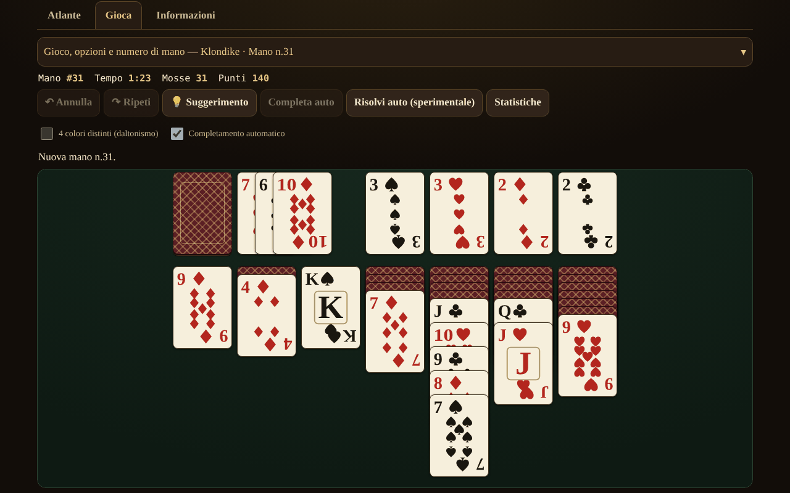

# Solitaire fără frontiere

[English](README.md) · [Română](README.ro.md) · [Français](README.fr.md) · **Italiano** · [Español](README.es.md) · [Português](README.pt.md) · [Deutsch](README.de.md) · [Magyar](README.hu.md)

**Versione:** 1.2.4 · **Ultimo aggiornamento:** 2026-10-23

Lingue dell'interfaccia: **Română, English, Français, Italiano, Español, Português (PT), Deutsch, Magyar**

Atlante di solitari (patience) con le carte — 13 giochi per un solo giocatore, in un unico file HTML, offline, senza account e senza telemetria.

**App online:** https://chiuta.github.io/Solitaire-fara-frontiere/

## Che cos'è

Un atlante (schede con origine, regole, punteggio, etichette e il pulsante «▶ Gioca») più un motore comune di pile / fondazioni / mazzo / tableau con regole parametrizzate. Non c'è avversario e non c'è un'IA di gioco: al suo posto, **«Suggerimento»** usa un solver con limite di nodi/tempo, e **«Risolvi automaticamente»** (facoltativo) esegue il piano trovato dal solver. Le carte sono disegnate con SVG proprio (♠♥♦♣, modalità facoltativa a 4 colori).

## Funzioni (verificate nel codice e nei test)

- 13 giochi giocabili, con opzioni (vedi la tabella).
- Numero di smazzata riproducibile (1 … 2.147.483.647), «nuova smazzata» (crypto.getRandomValues con campionamento per rifiuto) e «stessa smazzata».
- Annulla / Ripristina illimitati; Annulla ripristina esattamente anche il punteggio.
- Spostamento con trascinamento (pointer events, `touch-action`), con clic-clic, con doppio tocco (spostamento automatico) e da tastiera (frecce / Invio / Spazio).
- Completamento automatico alla fine; mosse sicure automatiche verso le fondazioni (facoltativo, disattivabile).
- Cronometro, mosse, punteggio (vedi «Punteggio»).
- Suggerimento tramite solver, con alternative a pressioni ripetute (ordinate euristicamente, non verificate); «Si può risolvere?» solo per FreeCell, con risultato a tre stati: *risolvibile* / *non risolto entro il limite* / *non so* — mai certezza.
- Statistiche locali facoltative (localStorage, in try/catch; l'applicazione funziona anche senza).
- 8 lingue per l'interfaccia: RO / EN / FR / IT / ES / PT / DE / HU, con rilevamento automatico, `lang` dinamico e script di parità delle chiavi (155 chiavi × 7 lingue).
- Mobile-first: 390 px senza scorrimento orizzontale, sovrapposizione adattiva delle carte, aria-live per i messaggi, focus visibile, `prefers-reduced-motion`, `<noscript>`.

### Giochi

| Gioco | Giocabile? | ⚠ Approssimazioni / scelte di regole |
|---|---|---|
| Klondike (pesca 1/3; 0, 1 o 3 passaggi; punteggio standard / Vegas / nessuno) | sì | Penalità di −20 alla pesca di 3 (dal 4° passaggio): confermata da due fonti secondarie (rarepike.com, solitairecat.com); Wikipedia riporta solo −100 alla pesca di 1 |
| FreeCell (3/4/5 celle; supermossa attivabile) | sì | la numerazione delle smazzate è algoritmica, compatibile con l'LCG di Microsoft (verificata sulla n. 1) |
| Spider (1/2/4 semi) | sì | punteggio 500 / −1 per mossa / +100 per sequenza; Annulla ripristina il punteggio (differenza rispetto alle implementazioni classiche) |
| Yukon | sì | — |
| Pyramid | sì | ⚠ cima del mazzo disponibile; 2 ridistribuzioni per impostazione predefinita; vittoria «rilassata» per impostazione predefinita; punteggio proprio |
| TriPeaks | sì | ⚠ punteggio proprio (serie); opzione di ciclo A–K |
| Golf | sì | ⚠ punteggio proprio (carte eliminate); Re «bloccato» (tradizionale), opzioni di ciclo / K–Q |
| Scorpion | sì | — |
| Canfield | sì | ⚠ riempimento dei vuoti solo dagli scarti; spostamento dell'intera colonna rigoroso per impostazione predefinita |
| Forty Thieves | sì | — |
| Clock | sì | puro caso (≈1/13); nessuna decisione |
| Baker's Dozen | sì | — |
| Eight Off | sì | vuoto: re / qualsiasi (opzione) |
| Spiderette, Seahaven Towers, Beleaguered Castle, Calculation, Accordion, Aces Up, Russian | **solo nell'atlante** | schede di regole, senza gioco |

Klondike Aces non è implementato.

### Punteggio

- **Klondike standard:** scarti→tableau +5, scarti→fondazione +10, tableau→fondazione +10, carta scoperta +5, fondazione→tableau −15, riciclo alla pesca di 1: −100, alla pesca di 3: −20 dal 4° passaggio; minimo 0; nessun bonus di tempo.
- **Klondike Vegas:** −52 all'inizio, +5 per ogni carta portata in fondazione.
- Spider, TriPeaks, Golf, Pyramid, Clock: vedi le schede dell'atlante; TriPeaks e Golf usano convenzioni proprie, non uno standard ufficiale.

## Guida all'uso

1. Apri `index.html` (o la pagina online). La scheda **Atlante** elenca i giochi; filtra o cerca.
2. Premi **▶ Gioca** su una scheda; scegli le opzioni (pesca, semi, celle…) e, se vuoi, scrivi un numero di smazzata.
3. Muovi: trascina una carta, **oppure** premi la carta e poi la destinazione, **oppure** usa le frecce + Invio. Il doppio tocco su una carta la porta automaticamente dove è possibile.
4. **Suggerimento** mostra la mossa successiva; **Annulla / Ripristina** sono illimitati; **Nuova smazzata** / **Stessa smazzata** riavviano.
5. Solo per FreeCell: **Si può risolvere?** esegue il solver con un limite; **Risolvi automaticamente** esegue il piano trovato.
6. Il pannello dei comandi è comprimibile sugli schermi stretti.

## Riservatezza e rete

Zero richieste di rete (nessun fetch/XHR, nessun font o CDN esterno), zero telemetria. CSP rigorosa in `<meta>`: `default-src 'none'`, `img-src data:`, senza `connect-src`; lo script è consentito tramite hash SHA-256 (senza `unsafe-inline` per gli script); `style-src 'unsafe-inline'` è mantenuto perché le carte sono posizionate tramite attributi `style`. localStorage (`sol.stats.v1`, `sol.prefs.v1`) solo in try/catch. Gli unici link esterni (Buy Me a Coffee) hanno `rel="noopener"`.

## Limiti e avvertenze

- **Il solver non è una DFS**, ma una ricerca best-first (euristica, portafoglio di 3 ponderazioni) con limite di nodi e di tempo. **Vede le carte nascoste** (informazione perfetta): è un aiuto, non una simulazione fedele di un giocatore. Il fatto che non trovi una soluzione **non** significa che la smazzata sia irrisolvibile.
- Il tasso di risoluzione di Klondike misurato (60.000 nodi, 300 smazzate, informazione perfetta) è solo un **limite inferiore**: pesca 1 ≥ 67,3%, pesca 3 ≥ 59,0% (4,7% completamente esaurite).
- «Esaurito» a FreeCell (es. n. 11982, 61.643 stati) è un forte indizio, non una dimostrazione formale.
- Spider: il solver qui è debole (e l'audit lo conferma) — su 10 smazzate (1 seme, poi 2 semi) non ha trovato alcun piano completo in 150.000 nodi / 5 s; il suggerimento è solo una mossa euristica, non un piano fino alla vittoria. La risoluzione automatica di Spider non è affidabile.
- Aree di tocco: nei giochi con ≥ 8 colonne (Spider, Forty Thieves, Baker's Dozen, TriPeaks, FreeCell con 5 celle) le carte sono larghe almeno 44 px; sugli schermi stretti il tavolo scorre orizzontalmente nel suo contenitore (pulsanti ◀ ▶, scorrimento con il dito sullo sfondo, scorrimento automatico durante il trascinamento). L'opzione «Adatta tutto il tavolo» torna a carte piccole. A 320 px i giochi con 7 colonne hanno carte da 40 px, e la parte visibile in altezza delle carte sovrapposte nelle colonne è < 44 px (inerente al solitario).
- Le scorciatoie da tastiera (U/Y/H/A/N) sono attive solo con il tavolo in focus; N richiede due pressioni se il gioco è iniziato.
- Il solver ha un tetto di memoria (30.000 stati aperti) e viene eseguito in brevi frammenti; il «Suggerimento» euristico è etichettato «non verificato, può portare a una posizione bloccata».
- Il messaggio «non ci sono più mosse utili» può mancare in posizioni bloccate in cui esistono ancora mosse senza effetto (es. un'intera colonna su una colonna vuota) o riciclaggi illimitati del mazzo.
- «Nuova smazzata» sceglie tra 1.000.000 di numeri (come nel FreeCell di Microsoft), non tra tutte le permutazioni possibili.
- I testi lunghi dell'atlante sono completi solo in RO e EN; in FR/IT/ES/PT/DE/HU viene mostrato l'inglese con la nota «testo in inglese». I pulsanti e i messaggi sono tradotti in tutte e 8 le lingue.
- I test sono fuori dal pacchetto (non fanno parte del repo).

## Cronologia / Changelog

### 1.2.3 — 2026-10-22

fff-kit 1.1.4: target touch e dimensione minima del testo.

- 1.2.2 — 2026-10-22: fff-kit 1.1.2: PBKDF2 con 600.000 iterazioni, protezione anti-clickjacking
- 1.1.0 — 2026-10-14: copia di riserva ed etichettatura dei dati (fff-kit).

- 1.0.4 — 2026-10-12: la versione e la data dell'ultimo aggiornamento sono mostrate nell'applicazione
- Sugli schermi con altezza inferiore a 900 px (es. 1280×800) il pannello «Gioco e opzioni» parte chiuso, in modo che il tavolo da gioco sia visibile senza scorrere (il riepilogo mostra il gioco e il numero di smazzata; un chevron ▾ e un clic lo aprono); sugli schermi alti resta aperto. Spostamento, Annulla e cambio di gioco sono stati verificati dopo la modifica.
- Le schede Atlante / Gioca / Informazioni e il widget di sostegno sono ora in landmark semantici (`main`, `complementary`); axe-core: 0 violazioni a 1280 e 360 px.
- L'hash CSP dello script è stato ricalcolato dopo l'aggiornamento del numero di versione (v1.0 → v1.0.1).
- «Suggerimento»: pressioni ripetute sulla stessa posizione danno ora mosse alternative (ordinate euristicamente, marcate «non verificato»), finché non resta alcuna mossa utile («Non ho altre mosse da suggerire»); 2 nuove chiavi di interfaccia in tutte e 7 le lingue (155 chiavi × 7 lingue).

## Fonti

Regole consultate: Wikipedia (Klondike, FreeCell, Spider, Yukon, Pyramid, Golf, Scorpion, Canfield, Forty Thieves, Clock, Baker's Dozen, Eight Off); solitairebliss.com (TriPeaks); solitairelaboratory.com (Golf); il generatore di smazzate di Microsoft FreeCell (LCG `s = s·214013 + 2531011 mod 2^31`, risultato `s >> 16`), verificato sulla smazzata n. 1 nota. La smazzata n. 11982 (nota come irrisolvibile) è segnalata dal solver come «spazio esaurito»; il fatto si basa sulla letteratura su FreeCell, non su una fonte qui consultata.

## Esecuzione locale

Apri `index.html` in un browser — non richiede server, build o installazione.

## Licenza

MIT — vedi il file LICENSE.

## Autore

Alexio — Alexandru-Ionuț Chiuță (alexio@trom.tf)

## Riepilogo

Un atlante offline in un unico file di 13 giochi di solitario giocabili da un solo giocatore (Klondike, FreeCell, Spider, Yukon, Pyramid, TriPeaks, Golf, Scorpion, Canfield, Forty Thieves, Clock, Baker's Dozen, Eight Off) più 7 voci solo atlante. Numeri di smazzata riproducibili, annulla/ripristina illimitati, gioco con trascinamento / clic / tastiera, e un solver best-first con limite di nodi per i suggerimenti e una risoluzione automatica facoltativa (vede le carte nascoste; un fallimento non prova mai l'irrisolvibilità). Carte SVG proprie, 8 lingue dell'interfaccia, CSP rigorosa, nessuna rete, nessuna telemetria. Contrassegnato ⚠ dove le regole sono approssimate; i tassi di risoluzione di Klondike sono riportati solo come limiti inferiori.
