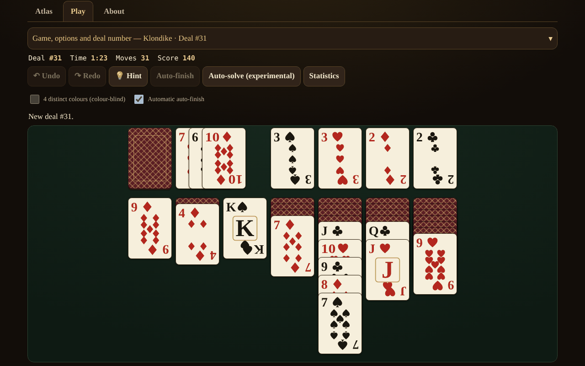

# Solitaire fără frontiere

**English** · [Română](README.ro.md) · [Français](README.fr.md) · [Italiano](README.it.md) · [Español](README.es.md) · [Português](README.pt.md) · [Deutsch](README.de.md) · [Magyar](README.hu.md)

**Version:** 1.2.4 · **Last updated:** 2026-10-23

Interface languages: **Română, English, Français, Italiano, Español, Português (PT), Deutsch, Magyar**

An atlas of card solitaire (patience) — 13 single-player games you can play, in a single HTML file, offline, with no account and no telemetry.

**Live app:** https://chiuta.github.io/Solitaire-fara-frontiere/

## What it is

An atlas (sheets with origin, rules, scoring, tags and the "▶ Play" button) plus a common engine of piles / foundations / stock / tableau with parameterized rules. There is no opponent and no game AI: in its place, **"Hint"** uses a solver with a node/time limit, and **"Auto-solve"** (optional) runs the plan found by the solver. The cards are drawn with custom SVG (♠♥♦♣, optional 4-colour mode).

## Features (verified in code and in tests)

- 13 playable games, with options (see the table).
- Reproducible deal number (1 … 2,147,483,647), "new deal" (crypto.getRandomValues with rejection sampling) and "same deal".
- Unlimited Undo / Redo; Undo restores the score exactly too.
- Moving by dragging (pointer events, `touch-action`), by click-click, by double-tap (automatic move) and from the keyboard (arrows / Enter / Space).
- Auto-completion at the end; safe automatic moves to the foundations (optional, can be turned off).
- Timer, moves, score (see "Scoring").
- Hint through the solver, with alternatives on repeated presses (ranked heuristically, unverified); "Can it be solved?" only for FreeCell, with a tri-state result: *solvable* / *not solved within the limit* / *unknown* — never certainty.
- Optional local statistics (localStorage, in try/catch; the application also works without it).
- 8 interface languages: RO / EN / FR / IT / ES / PT / DE / HU, with auto-detection, dynamic `lang` and a key-parity script (155 keys × 7 languages).
- Mobile-first: 390 px with no horizontal scroll, adaptive card overlap, aria-live for messages, visible focus, `prefers-reduced-motion`, `<noscript>`.

### Games

| Game | Playable? | ⚠ Approximations / rule choices |
|---|---|---|
| Klondike (draw 1/3; 0, 1 or 3 passes; standard / Vegas / no scoring) | yes | The −20 penalty at draw 3 (from the 4th pass): confirmed by two secondary sources (rarepike.com, solitairecat.com); Wikipedia gives only −100 at draw 1 |
| FreeCell (3/4/5 cells; supermove can be enabled) | yes | deal numbering is algorithmic, compatible with Microsoft's LCG (verified on #1) |
| Spider (1/2/4 suits) | yes | scoring 500 / −1 per move / +100 per sequence; Undo restores the score (a difference from classic implementations) |
| Yukon | yes | — |
| Pyramid | yes | ⚠ top of the stock available; 2 redeals by default; "relaxed" win by default; own scoring |
| TriPeaks | yes | ⚠ own scoring (streaks); wrap A–K option |
| Golf | yes | ⚠ own scoring (cards removed); King "blocked" (traditional), wrap / K–Q options |
| Scorpion | yes | — |
| Canfield | yes | ⚠ filling gaps only from the waste; moving a whole column strict by default |
| Forty Thieves | yes | — |
| Clock | yes | pure chance (≈1/13); no decisions |
| Baker's Dozen | yes | — |
| Eight Off | yes | space: king / any (option) |
| Spiderette, Seahaven Towers, Beleaguered Castle, Calculation, Accordion, Aces Up, Russian | **atlas only** | rule sheets, no game |

Klondike Aces is not implemented.

### Scoring

- **Standard Klondike:** waste→tableau +5, waste→foundation +10, tableau→foundation +10, card turned over +5, foundation→tableau −15, recycling at draw 1: −100, at draw 3: −20 from the 4th pass; minimum 0; no time bonus.
- **Vegas Klondike:** −52 at the start, +5 per card moved up to the foundation.
- Spider, TriPeaks, Golf, Pyramid, Clock: see the sheets in the atlas; TriPeaks and Golf use their own conventions, not an official standard.

## User guide

1. Open `index.html` (or the Live page). The **Atlas** tab lists the games; filter or search.
2. Press **▶ Play** on a sheet; choose the options (draw, suits, cells…) and, if you want, type a deal number.
3. Move: drag a card, **or** press the card and then the destination, **or** use the arrows + Enter. Double-tapping a card moves it automatically wherever possible.
4. **Hint** shows the next move; **Undo / Redo** are unlimited; **New deal** / **Same deal** restart.
5. FreeCell only: **Can it be solved?** runs the solver with a limit; **Auto-solve** executes the plan found.
6. The control panel can be collapsed on narrow screens.

## Privacy and network

Zero network requests (no fetch/XHR, no external fonts or CDN), zero telemetry. Strict CSP in `<meta>`: `default-src 'none'`, `img-src data:`, no `connect-src`; the script is allowed by SHA-256 hash (no `unsafe-inline` for scripts); `style-src 'unsafe-inline'` is kept because the cards are positioned through `style` attributes. localStorage (`sol.stats.v1`, `sol.prefs.v1`) only in try/catch. The only external links (Buy Me a Coffee) have `rel="noopener"`.

## Limits and warnings

- **The solver is not DFS**, but a best-first search (heuristic, a portfolio of 3 weightings) with a node and time limit. **It sees the hidden cards** (perfect information): it is an aid, not a faithful simulation of a player. The fact that it finds no solution does **not** mean the deal is unsolvable.
- The measured Klondike solve rate (60,000 nodes, 300 deals, perfect information) is only a **lower bound**: draw 1 ≥ 67.3%, draw 3 ≥ 59.0% (4.7% fully exhausted).
- "Exhausted" in FreeCell (e.g. #11982, 61,643 states) is a strong indication, not a formal proof.
- Spider: the solver is weak here (and confirmed by the audit) — on 10 deals (1 suit, then 2 suits) it found no complete plan within 150,000 nodes / 5 s; the hint is only a heuristic move, not a plan to victory. Spider auto-solve is not reliable.
- Touch targets: in games with ≥8 columns (Spider, Forty Thieves, Baker's Dozen, TriPeaks, FreeCell with 5 cells) the cards are at least 44 px wide; on narrow screens the table scrolls horizontally within its container (◀ ▶ buttons, finger scrolling on the background, automatic scrolling while dragging). The "Fit the whole table" option goes back to small cards. At 320 px, games with 7 columns have 40 px cards, and the visible height of overlapping cards in columns is < 44 px (inherent to solitaire).
- Key shortcuts (U/Y/H/A/N) are active only with the table in focus; N asks for two presses if the game has been started.
- The solver has a memory ceiling (30,000 open states) and runs in short chunks; the heuristic "Hint" is labelled "unverified, may lead to a blocked position".
- The message "no useful moves left" may be missing in blocked positions where moves without effect still exist (e.g. a whole column onto an empty column) or unlimited stock recycling.
- "New deal" chooses among 1,000,000 numbers (as in Microsoft FreeCell), not among all possible permutations.
- The long texts in the atlas are complete only in RO and EN; in FR/IT/ES/PT/DE/HU English is shown with the note "text in English". Buttons and messages are translated into all 8 languages.
- The tests are outside the package (they are not part of the repo).

## History / Changelog

### 1.2.3 — 2026-10-22

fff-kit 1.1.4: touch targets and minimum text size.

- 1.2.2 — 2026-10-22: fff-kit 1.1.2: PBKDF2 600,000 iterations, anti-clickjacking protection
- 1.1.0 — 2026-10-14: Backup and data labelling (fff-kit).

- 1.0.4 — 2026-10-12: the version and the date of the last update are shown in the application
- On screens with a height below 900 px (e.g. 1280×800) the "Game and options" panel starts closed, so that the game table is visible without scrolling (the summary shows the game and the deal number; a ▾ chevron and a click open it); on tall screens it stays open. Moving, Undo and switching games were verified after the change.
- The Atlas / Play / About tabs and the support widget are now in semantic landmarks (`main`, `complementary`); axe-core: 0 violations at 1280 and 360 px.
- The CSP hash of the script was recomputed after updating the version number (v1.0 → v1.0.1).
- "Hint": repeated presses on the same position now give alternative moves (ranked heuristically, marked "unverified"), until no useful move remains ("I have no more moves to suggest"); 2 new interface keys in all 7 languages (155 keys × 7 languages).

## Sources

Rules consulted: Wikipedia (Klondike, FreeCell, Spider, Yukon, Pyramid, Golf, Scorpion, Canfield, Forty Thieves, Clock, Baker's Dozen, Eight Off); solitairebliss.com (TriPeaks); solitairelaboratory.com (Golf); the Microsoft FreeCell deal generator (LCG `s = s·214013 + 2531011 mod 2^31`, result `s >> 16`), verified on the known deal #1. Deal #11982 (known to be unsolvable) is reported by the solver as "space exhausted"; the fact is based on the FreeCell literature, not on a source consulted here.

## Running locally

Open `index.html` in a browser — it needs no server, build or installation.

## License

MIT — see the LICENSE file.

## Author

Alexio — Alexandru-Ionuț Chiuță (alexio@trom.tf)

## Summary

An offline, single-file atlas of 13 playable single-player solitaire games (Klondike, FreeCell, Spider, Yukon, Pyramid, TriPeaks, Golf, Scorpion, Canfield, Forty Thieves, Clock, Baker's Dozen, Eight Off) plus 7 atlas-only entries. Reproducible deal numbers, unlimited undo/redo, drag / click / keyboard play, and a node-limited best-first solver for hints and an optional auto-solve (it sees hidden cards; a failure never proves unsolvability). Own SVG cards, 8 UI languages, strict CSP, no network, no telemetry. Marked ⚠ where rules are approximated; Klondike solve rates are reported as lower bounds only.
