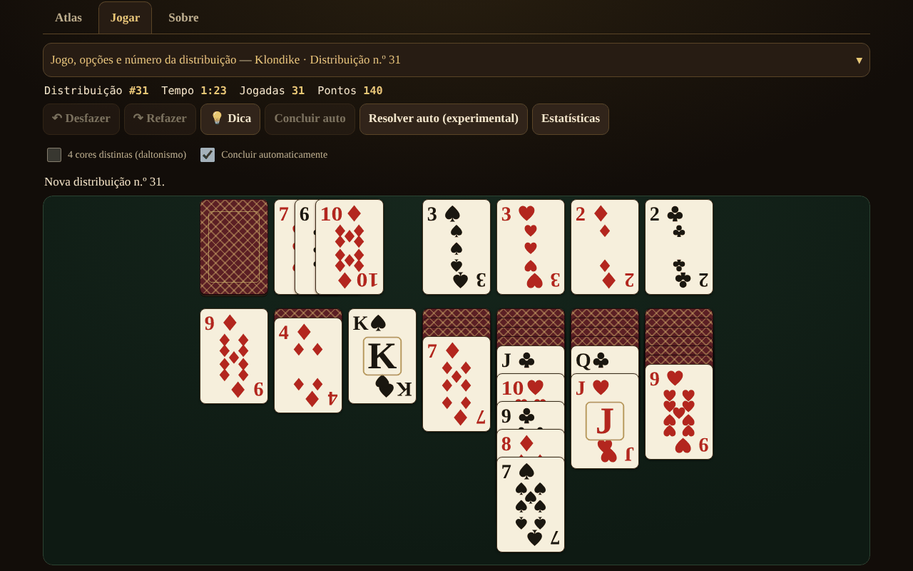

# Solitaire fără frontiere

[English](README.md) · [Română](README.ro.md) · [Français](README.fr.md) · [Italiano](README.it.md) · [Español](README.es.md) · **Português** · [Deutsch](README.de.md) · [Magyar](README.hu.md)

**Versão:** 1.2.2 · **Última atualização:** 2026-10-22

Idiomas da interface: **Română, English, Français, Italiano, Español, Português (PT), Deutsch, Magyar**

Atlas de solitários (paciências) de cartas — 13 jogos para um só jogador, num único ficheiro HTML, offline, sem conta e sem telemetria.

**Aplicação online:** https://chiuta.github.io/Solitaire-fara-frontiere/

## O que é

Um atlas (fichas com origem, regras, pontuação, etiquetas e o botão «▶ Jogar») mais um motor comum de pilhas / fundações / baralho / tableau com regras parametrizadas. Não há adversário nem IA de jogo: em seu lugar, **«Sugestão»** usa um solver com limite de nós/tempo, e **«Resolver automaticamente»** (opcional) executa o plano encontrado pelo solver. As cartas são desenhadas com SVG próprio (♠♥♦♣, modo opcional de 4 cores).

## Funcionalidades (verificadas no código e nos testes)

- 13 jogos jogáveis, com opções (ver a tabela).
- Número de distribuição reproduzível (1 … 2 147 483 647), «nova distribuição» (crypto.getRandomValues com amostragem por rejeição) e «mesma distribuição».
- Anular / Refazer ilimitados; Anular restaura também exatamente a pontuação.
- Movimento por arrastamento (pointer events, `touch-action`), por clique-clique, por toque duplo (movimento automático) e pelo teclado (setas / Enter / Espaço).
- Conclusão automática no final; jogadas seguras automáticas para as fundações (opcional, desativável).
- Cronómetro, jogadas, pontuação (ver «Pontuação»).
- Sugestão através do solver, com alternativas em pressões repetidas (classificadas heuristicamente, não verificadas); «Tem solução?» apenas para o FreeCell, com um resultado de três estados: *resolúvel* / *não resolvido dentro do limite* / *não sei* — nunca certeza.
- Estatísticas locais opcionais (localStorage, em try/catch; a aplicação funciona também sem elas).
- 8 idiomas de interface: RO / EN / FR / IT / ES / PT / DE / HU, com deteção automática, `lang` dinâmico e script de paridade de chaves (155 chaves × 7 idiomas).
- Mobile-first: 390 px sem deslocamento horizontal, sobreposição adaptativa das cartas, aria-live para mensagens, foco visível, `prefers-reduced-motion`, `<noscript>`.

### Jogos

| Jogo | Jogável? | ⚠ Aproximações / escolhas de regras |
|---|---|---|
| Klondike (compra 1/3; 0, 1 ou 3 passagens; pontuação padrão / Vegas / nenhuma) | sim | Penalização de −20 na compra de 3 (a partir da 4.ª passagem): confirmada por duas fontes secundárias (rarepike.com, solitairecat.com); a Wikipédia indica apenas −100 na compra de 1 |
| FreeCell (3/4/5 células; supermovimento ativável) | sim | a numeração das distribuições é algorítmica, compatível com o LCG da Microsoft (verificada na n.º 1) |
| Spider (1/2/4 naipes) | sim | pontuação 500 / −1 por jogada / +100 por sequência; Anular restaura a pontuação (diferença em relação às implementações clássicas) |
| Yukon | sim | — |
| Pyramid | sim | ⚠ topo do baralho disponível; 2 redistribuições por predefinição; vitória «relaxada» por predefinição; pontuação própria |
| TriPeaks | sim | ⚠ pontuação própria (séries); opção de ciclo A–K |
| Golf | sim | ⚠ pontuação própria (cartas eliminadas); Rei «bloqueado» (tradicional), opções de ciclo / K–Q |
| Scorpion | sim | — |
| Canfield | sim | ⚠ preenchimento de espaços apenas a partir do descarte; movimento da coluna inteira estrito por predefinição |
| Forty Thieves | sim | — |
| Clock | sim | puro acaso (≈1/13); sem decisões |
| Baker's Dozen | sim | — |
| Eight Off | sim | espaço: rei / qualquer (opção) |
| Spiderette, Seahaven Towers, Beleaguered Castle, Calculation, Accordion, Aces Up, Russian | **apenas no atlas** | fichas de regras, sem jogo |

O Klondike Aces não está implementado.

### Pontuação

- **Klondike padrão:** descarte→tableau +5, descarte→fundação +10, tableau→fundação +10, carta virada +5, fundação→tableau −15, reciclagem na compra de 1: −100, na compra de 3: −20 a partir da 4.ª passagem; mínimo 0; sem bónus de tempo.
- **Klondike Vegas:** −52 no início, +5 por carta levada para a fundação.
- Spider, TriPeaks, Golf, Pyramid, Clock: ver as fichas do atlas; TriPeaks e Golf usam convenções próprias, não um padrão oficial.

## Manual de utilização

1. Abra `index.html` (ou a página online). O separador **Atlas** lista os jogos; filtre ou pesquise.
2. Prima **▶ Jogar** numa ficha; escolha as opções (compra, naipes, células…) e, se quiser, escreva um número de distribuição.
3. Mova: arraste uma carta, **ou** prima a carta e depois o destino, **ou** use as setas + Enter. O toque duplo numa carta leva-a automaticamente para onde for possível.
4. **Sugestão** mostra a jogada seguinte; **Anular / Refazer** são ilimitados; **Nova distribuição** / **Mesma distribuição** reiniciam.
5. Apenas no FreeCell: **Tem solução?** executa o solver com um limite; **Resolver automaticamente** executa o plano encontrado.
6. O painel de comandos é recolhível em ecrãs estreitos.

## Privacidade e rede

Zero pedidos de rede (sem fetch/XHR, sem tipos de letra nem CDN externos), zero telemetria. CSP rigorosa em `<meta>`: `default-src 'none'`, `img-src data:`, sem `connect-src`; o script é permitido por hash SHA-256 (sem `unsafe-inline` para scripts); `style-src 'unsafe-inline'` é mantido porque as cartas são posicionadas através de atributos `style`. localStorage (`sol.stats.v1`, `sol.prefs.v1`) apenas em try/catch. As únicas ligações externas (Buy Me a Coffee) têm `rel="noopener"`.

## Limites e avisos

- **O solver não é DFS**, mas uma pesquisa melhor-primeiro (heurística, carteira de 3 ponderações) com limite de nós e de tempo. **Vê as cartas ocultas** (informação perfeita): é uma ajuda, não uma simulação fiel de um jogador. O facto de não encontrar solução **não** significa que a distribuição seja irresolúvel.
- A taxa de resolução do Klondike medida (60 000 nós, 300 distribuições, informação perfeita) é apenas um **limite inferior**: compra 1 ≥ 67,3 %, compra 3 ≥ 59,0 % (4,7 % completamente esgotadas).
- «Esgotado» no FreeCell (p. ex. n.º 11982, 61 643 estados) é um indício forte, não uma demonstração formal.
- Spider: o solver é fraco aqui (e a auditoria confirma-o) — em 10 distribuições (1 naipe, depois 2 naipes) não encontrou nenhum plano completo em 150 000 nós / 5 s; a sugestão é apenas uma jogada heurística, não um plano até à vitória. A resolução automática do Spider não é fiável.
- Alvos de toque: nos jogos com ≥ 8 colunas (Spider, Forty Thieves, Baker's Dozen, TriPeaks, FreeCell com 5 células) as cartas têm pelo menos 44 px de largura; em ecrãs estreitos a mesa desloca-se horizontalmente dentro do seu contentor (botões ◀ ▶, deslocamento com o dedo sobre o fundo, deslocamento automático ao arrastar). A opção «Ajustar toda a mesa» volta a cartas pequenas. A 320 px os jogos de 7 colunas têm cartas de 40 px, e a parte visível em altura das cartas sobrepostas nas colunas é < 44 px (inerente ao solitário).
- Os atalhos de teclado (U/Y/H/A/N) só estão ativos com a mesa em foco; N pede duas pressões se o jogo tiver começado.
- O solver tem um teto de memória (30 000 estados abertos) e é executado em fragmentos curtos; a «Sugestão» heurística está etiquetada como «não verificada, pode levar a uma posição bloqueada».
- A mensagem «não há mais jogadas úteis» pode faltar em posições bloqueadas em que ainda existem jogadas sem efeito (p. ex. uma coluna inteira para uma coluna vazia) ou reciclagens ilimitadas do baralho.
- «Nova distribuição» escolhe entre 1 000 000 de números (como no FreeCell da Microsoft), não entre todas as permutações possíveis.
- Os textos longos do atlas estão completos apenas em RO e EN; em FR/IT/ES/PT/DE/HU é mostrado o inglês com a nota «texto em inglês». Os botões e as mensagens estão traduzidos nos 8 idiomas.
- Os testes estão fora do pacote (não fazem parte do repositório).

## Histórico / Registo de alterações

- 1.2.2 — 2026-10-22: fff-kit 1.1.2: PBKDF2 com 600.000 iterações, proteção anti-clickjacking
- 1.1.0 — 2026-10-14: cópia de segurança e etiquetagem de dados (fff-kit).

- 1.0.4 — 2026-10-12: a versão e a data da última atualização são mostradas na aplicação
- Em ecrãs com altura inferior a 900 px (p. ex. 1280×800) o painel «Jogo e opções» arranca fechado, para que a mesa de jogo fique visível sem deslocar (o resumo mostra o jogo e o número de distribuição; um chevron ▾ e um clique abrem-no); em ecrãs altos permanece aberto. O movimento, Anular e a mudança de jogo foram verificados após a alteração.
- Os separadores Atlas / Jogar / Acerca de e o widget de apoio estão agora em marcos semânticos (`main`, `complementary`); axe-core: 0 violações a 1280 e 360 px.
- O hash CSP do script foi recalculado após a atualização do número de versão (v1.0 → v1.0.1).
- «Sugestão»: pressões repetidas sobre a mesma posição dão agora jogadas alternativas (classificadas heuristicamente, marcadas «não verificado»), até não restar nenhuma jogada útil («Não tenho mais jogadas para sugerir»); 2 novas chaves de interface nos 7 idiomas (155 chaves × 7 idiomas).

## Fontes

Regras consultadas: Wikipédia (Klondike, FreeCell, Spider, Yukon, Pyramid, Golf, Scorpion, Canfield, Forty Thieves, Clock, Baker's Dozen, Eight Off); solitairebliss.com (TriPeaks); solitairelaboratory.com (Golf); o gerador de distribuições do Microsoft FreeCell (LCG `s = s·214013 + 2531011 mod 2^31`, resultado `s >> 16`), verificado na distribuição n.º 1 conhecida. A distribuição n.º 11982 (conhecida como irresolúvel) é comunicada pelo solver como «espaço esgotado»; o facto baseia-se na literatura sobre o FreeCell, não numa fonte aqui consultada.

## Execução local

Abra `index.html` num navegador — não precisa de servidor, compilação ou instalação.

## Licença

MIT — veja o ficheiro LICENSE.

## Autor

Alexio — Alexandru-Ionuț Chiuță (alexio@trom.tf)

## Resumo

Um atlas offline, num único ficheiro, de 13 jogos de solitário jogáveis por um só jogador (Klondike, FreeCell, Spider, Yukon, Pyramid, TriPeaks, Golf, Scorpion, Canfield, Forty Thieves, Clock, Baker's Dozen, Eight Off) mais 7 entradas apenas de atlas. Números de distribuição reproduzíveis, anular/refazer ilimitados, jogo com arrastamento / clique / teclado, e um solver melhor-primeiro com limite de nós para as sugestões e uma resolução automática opcional (vê as cartas ocultas; uma falha nunca prova a irresolubilidade). Cartas SVG próprias, 8 idiomas de interface, CSP rigorosa, sem rede, sem telemetria. Marcado com ⚠ onde as regras são aproximadas; as taxas de resolução do Klondike são indicadas apenas como limites inferiores.
