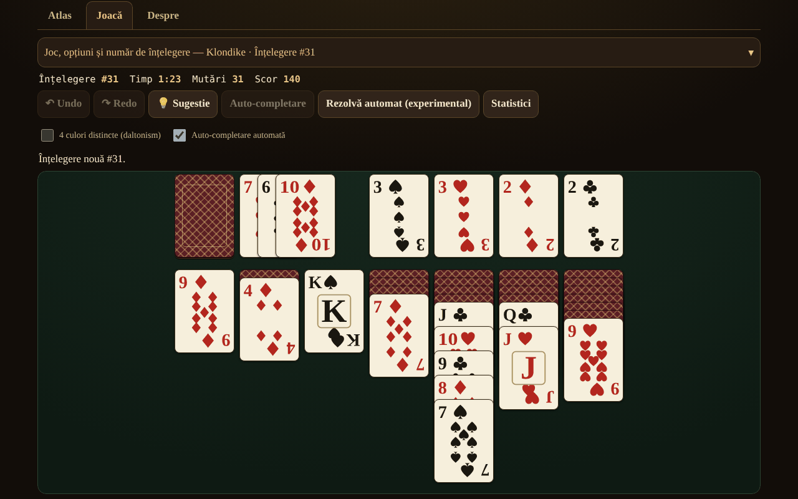

# Solitaire fără frontiere

[English](README.md) · **Română** · [Français](README.fr.md) · [Italiano](README.it.md) · [Español](README.es.md) · [Português](README.pt.md) · [Deutsch](README.de.md) · [Magyar](README.hu.md)

**Versiune:** 2.1.0 · **Ultima actualizare:** 2026-10-27

Limbile interfeței: **Română, English, Français, Italiano, Español, Português (PT), Deutsch, Magyar**

Atlas de solitaire (patience) cu cărți — 13 jocuri jucabile de un singur jucător, într-un singur fișier HTML, offline, fără cont și fără telemetrie.

**Live:** https://chiuta.github.io/Solitaire-fara-frontiere/

**Nou în 2.1.0:** statisticile locale arată acum seria curentă și cea mai lungă serie de victorii pentru fiecare joc și set de opțiuni (aplicația oferea deja înțelegeri rezolvabile verificate și provocarea zilei). Vezi `CHANGELOG.md`.

## Ce este

Un atlas (fișe cu origine, reguli, punctaj, etichete și butonul „▶ Joacă") plus un motor comun de pile / fundații / stoc / tableau cu reguli parametrizate. Nu există adversar și nu există AI de joc: în locul lui, **„Sugestie"** folosește un solver cu limită de noduri/timp, iar **„Rezolvă automat"** (opțional) rulează planul găsit de solver. Cărțile sunt desenate cu SVG propriu (♠♥♦♣, mod opțional cu 4 culori).

## Funcții (verificate în cod și în teste)

- 13 jocuri jucabile, cu opțiuni (vezi tabelul).
- **v2.0.0 — înțelegeri rezolvabile garantate:** opțiunea „Doar înțelegeri rezolvabile (verificate)” caută, cu solverul local, o înțelegere pe care o și câștigă (planul e reluat mutare cu mutare înainte să fie acceptat); „Sugestie” și „Rezolvă automat” folosesc apoi planul. Merge bine la FreeCell, Eight Off, Klondike, Canfield, Yukon; la Spider și Forty Thieves solverul găsește rar soluții și căutarea poate eșua (limită 60 de încercări).
- **Provocarea zilei:** aceeași înțelegere (calculată din data UTC și joc) pentru oricine, fără server.
- Număr de înțelegere reproductibil (1 … 2 147 483 647), „înțelegere nouă" (crypto.getRandomValues cu rejection sampling) și „aceeași înțelegere".
- Undo / Redo nelimitat; Undo restabilește exact și scorul.
- Mutare prin tragere (pointer events, `touch-action`), prin click-click, prin dublu-tap (mutare automată) și de la tastatură (săgeți / Enter / Spațiu).
- Auto-completare la final; mutări sigure automate către fundații (opțional, dezactivabile).
- Cronometru, mutări, scor (vezi „Punctaj").
- Sugestie prin solver, cu alternative la apăsări repetate (clasate euristic, neverificat); „Se poate rezolva?" doar pentru FreeCell, cu rezultat tri-state: *rezolvabil* / *nerezolvat în limită* / *nu știu* — niciodată certitudine.
- Statistici locale opționale (localStorage, în try/catch; aplicația merge și fără).
- 8 limbi pentru interfață: RO / EN / FR / IT / ES / PT / DE / HU, cu autodetecție, `lang` dinamic și script de paritate a cheilor (155 chei × 7 limbi).
- Mobil-first: 390 px fără scroll orizontal, suprapunere adaptivă a cărților, aria-live pentru mesaje, focus vizibil, `prefers-reduced-motion`, `<noscript>`.

### Jocuri

| Joc | Jucabil? | ⚠ Aproximări / alegeri de reguli |
|---|---|---|
| Klondike (draw 1/3; 0, 1 sau 3 pasaje; punctaj standard / Vegas / fără) | da | Penalizarea −20 la draw 3 (din a 4-a trecere): confirmată de două surse secundare (rarepike.com, solitairecat.com); Wikipedia dă doar −100 la draw 1 |
| FreeCell (3/4/5 celule; supermutare activabilă) | da | numerotarea înțelegerilor este algoritmică, compatibilă cu LCG-ul Microsoft (verificat pe #1) |
| Spider (1/2/4 culori) | da | punctaj 500 / −1 pe mutare / +100 pe secvență; Undo restabilește scorul (diferență față de implementările clasice) |
| Yukon | da | — |
| Pyramid | da | ⚠ vârful stocului disponibil; 2 redistribuiri implicit; victorie „relaxată" implicită; punctaj propriu |
| TriPeaks | da | ⚠ punctaj propriu (serii); opțiune wrap A–K |
| Golf | da | ⚠ punctaj propriu (cărți eliminate); Regele „înfundat" (tradițional), opțiuni wrap / K–Q |
| Scorpion | da | — |
| Canfield | da | ⚠ completarea golurilor doar din deșeu; mutarea coloanei întregi implicit strictă |
| Forty Thieves | da | — |
| Clock | da | șansă pură (≈1/13); fără decizii |
| Baker's Dozen | da | — |
| Eight Off | da | gol: rege / orice (opțiune) |
| Spiderette, Seahaven Towers, Beleaguered Castle, Calculation, Accordion, Aces Up, Russian | **doar în atlas** | fișe cu reguli, fără joc |

Klondike Aces nu este implementat.

### Punctaj

- **Klondike standard:** deșeu→tableau +5, deșeu→fundație +10, tableau→fundație +10, carte întoarsă +5, fundație→tableau −15, reciclare draw 1: −100, draw 3: −20 de la a 4-a trecere; minim 0; fără bonus de timp.
- **Klondike Vegas:** −52 la început, +5 pe carte urcată în fundație.
- Spider, TriPeaks, Golf, Pyramid, Clock: vezi fișele din atlas; TriPeaks și Golf folosesc convenții proprii, nu un standard oficial.

## Manual de utilizare

1. Deschide `index.html` (sau pagina Live). Fila **Atlas** listează jocurile; filtrează sau caută.
2. Apasă **▶ Joacă** pe o fișă; alege opțiunile (draw, culori, celule…) și, dacă vrei, scrie un număr de înțelegere.
3. Mută: trage o carte, **sau** apasă cartea și apoi destinația, **sau** folosește săgețile + Enter. Dublu-tap pe o carte o duce automat unde se poate.
4. **Sugestie** arată următoarea mutare; **Anulează / Refă** sunt nelimitate; **Înțelegere nouă** / **Aceeași înțelegere** repornesc.
5. Doar la FreeCell: **Se poate rezolva?** rulează solverul cu limită; **Rezolvă automat** execută planul găsit.
6. Panoul de comenzi este pliabil pe ecrane înguste.

## Confidențialitate și rețea

Zero cereri de rețea (fără fetch/XHR, fără fonturi sau CDN externe), zero telemetrie. CSP strict în `<meta>`: `default-src 'none'`, `img-src data:`, fără `connect-src`; scriptul este permis prin hash SHA-256 (fără `unsafe-inline` pentru script); `style-src 'unsafe-inline'` este păstrat deoarece cărțile sunt poziționate prin atribute `style`. localStorage (`sol.stats.v1`, `sol.prefs.v1`) doar în try/catch. Singurele linkuri externe (Buy Me a Coffee) au `rel="noopener"`.

## Limite și avertismente

- **Solverul nu este DFS**, ci o căutare best-first (euristică, portofoliu de 3 ponderi) cu limită de noduri și de timp. **Vede cărțile ascunse** (informație perfectă): este un ajutor, nu o simulare corectă a unui jucător. Faptul că nu găsește soluție **nu** înseamnă că înțelegerea e nerezolvabilă.
- Rata de rezolvare Klondike măsurată (60 000 noduri, 300 înțelegeri, informație perfectă) este doar o **limită inferioară**: draw 1 ≥ 67,3 %, draw 3 ≥ 59,0 % (4,7 % epuizate complet).
- „Epuizat" la FreeCell (ex. #11982, 61 643 stări) este un indiciu puternic, nu o demonstrație formală.
- Spider: solverul este slab aici (și confirmat de audit) — pe 10 înțelegeri (1 culoare, apoi 2 culori) nu a găsit niciun plan complet în 150 000 noduri / 5 s; sugestia este doar o mutare euristică, nu un plan până la victorie. Auto-rezolvarea Spider nu este de încredere.
- Ținte tactile: la jocurile cu ≥8 coloane (Spider, Forty Thieves, Baker's Dozen, TriPeaks, FreeCell cu 5 celule) cărțile au minimum 44 px lățime; pe ecrane înguste masa se derulează orizontal în containerul ei (butoane ◀ ▶, derulare cu degetul pe fundal, derulare automată la tragere). Opțiunea „Încadrează toată masa” revine la cărți mici. La 320 px jocurile cu 7 coloane au cărți de 40 px, iar partea vizibilă pe înălțime a cărților suprapuse în coloane este < 44 px (inerent solitaire-ului).
- Scurtăturile de tastă (U/Y/H/A/N) sunt active doar cu masa în focus; N cere două apăsări dacă jocul e început.
- Solverul are plafon de memorie (30 000 stări deschise) și rulează în fragmente scurte; „Sugestia” euristică este etichetată „neverificat, poate duce într-o poziție blocată”.
- Mesajul „nu mai există mutări utile” poate lipsi în poziții blocate în care mai există mutări fără efect (ex. o coloană întreagă într-o coloană goală) sau reciclări nelimitate ale stocului.
- „Înțelegere nouă” alege dintre 1 000 000 de numere (ca la FreeCell Microsoft), nu din toate permutările posibile.
- Textele lungi din atlas sunt complete doar în RO și EN; în FR/IT/ES/PT/DE/HU se afișează engleza cu nota „text în engleză". Butoanele și mesajele sunt traduse în toate cele 8 limbi.
- Testele sunt în afara pachetului (nu fac parte din repo).

## Istoric / Changelog

### 1.2.5 — 2026-10-23

- Ținte tactile de cel puțin 44 px pe dispozitive tactile (`pointer:coarse`); desktopul rămâne neschimbat.

### 1.2.3 — 2026-10-22

fff-kit 1.1.4: ținte tactile și text minim.

- 1.2.2 — 2026-10-22: fff-kit 1.1.2: PBKDF2 600 000 iterații, protecție anti-clickjacking
- 1.1.0 — 2026-10-14: Copie de rezervă și etichetare date (fff-kit).

- 1.0.4 — 2026-10-12: versiunea și data ultimei actualizări sunt afișate în aplicație
- Pe ecrane cu înălțime sub 900 px (de ex. 1280×800) panoul „Joc și opțiuni” pornește închis, ca masa de joc să fie vizibilă fără derulare (rezumatul arată jocul și numărul înțelegerii; un chevron ▾ și un clic îl deschid); la ecrane înalte rămâne deschis. Mutarea, Undo și schimbarea jocului verificate după modificare.
- Filele Atlas / Joacă / Despre și widgetul de sprijin sunt acum în repere semantice (`main`, `complementary`); axe-core: 0 violări la 1280 și 360 px.
- Hash-ul CSP al scriptului a fost recalculat după actualizarea numărului de versiune (v1.0 → v1.0.1).
- „Sugestie”: apăsări repetate pe aceeași poziție dau acum mutări alternative (clasate euristic, marcate „neverificat”), până când nu mai rămâne nicio mutare utilă („Nu mai am alte mutări de sugerat”); 2 chei de interfață noi în toate cele 7 limbi (155 chei × 7 limbi).

## Surse

Reguli consultate: Wikipedia (Klondike, FreeCell, Spider, Yukon, Pyramid, Golf, Scorpion, Canfield, Forty Thieves, Clock, Baker's Dozen, Eight Off); solitairebliss.com (TriPeaks); solitairelaboratory.com (Golf); generatorul de înțelegeri Microsoft FreeCell (LCG `s = s·214013 + 2531011 mod 2^31`, rezultat `s >> 16`), verificat pe înțelegerea #1 cunoscută. Înțelegerea #11982 (cunoscută ca nerezolvabilă) este raportată de solver ca „spațiu epuizat"; faptul se bazează pe literatura FreeCell, nu pe o sursă consultată aici.

## Rulare locală

Deschide `index.html` într-un browser — nu necesită server, build sau instalare.

## Stare

Stabil, versiunea 2.1.0 (2026-10-27). 13 jocuri jucabile; sugestie și „Se poate rezolva?” printr-un solver cu limită de noduri și timp; „Doar înțelegeri rezolvabile (verificate)” (solverul găsește și reia un plan câștigător înainte să ofere înțelegerea; dacă nu găsește unul în limită, aplicația spune acest lucru); provocarea zilei; statistici locale cu serii. Un mod multiplayer local unificat între jocurile de cărți este planificat, nu implementat. Modificări: `CHANGELOG.md`.

## Offline

Un singur fișier, `index.html`: fără CDN, fără fonturi sau scripturi externe, fără urmărire, fără conturi. O politică CSP strictă blochează conexiunile de rețea; un service worker memorează aplicația pentru pornire offline. Statisticile și preferințele rămân doar în localStorage-ul acestui browser.

## Licență

MIT — vezi fișierul LICENSE.

## Autor

Alexio — Alexandru-Ionuț Chiuță (alexio@trom.tf)

## Rezumat

Un atlas offline, într-un singur fișier, cu 13 jocuri de solitaire individuale jucabile (Klondike, FreeCell, Spider, Yukon, Pyramid, TriPeaks, Golf, Scorpion, Canfield, Forty Thieves, Clock, Baker's Dozen, Eight Off) plus 7 intrări doar în atlas. Numere de împărțire reproductibile, undo/redo nelimitat, joc prin tragere / clic / tastatură și un solver best-first cu număr limitat de noduri pentru indicii și o rezolvare automată opțională (vede cărțile ascunse; un eșec nu dovedește niciodată că jocul nu are soluție). Cărți SVG proprii, 8 limbi de interfață, CSP strict, fără rețea, fără telemetrie. Marcat ⚠ acolo unde regulile sunt aproximate; ratele de rezolvare la Klondike sunt raportate doar ca limite inferioare.
